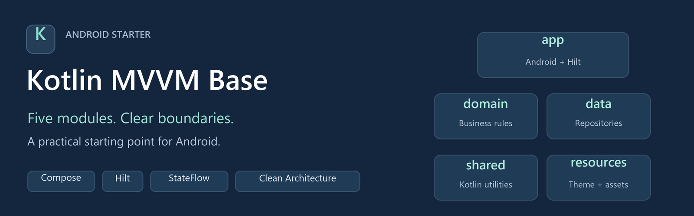
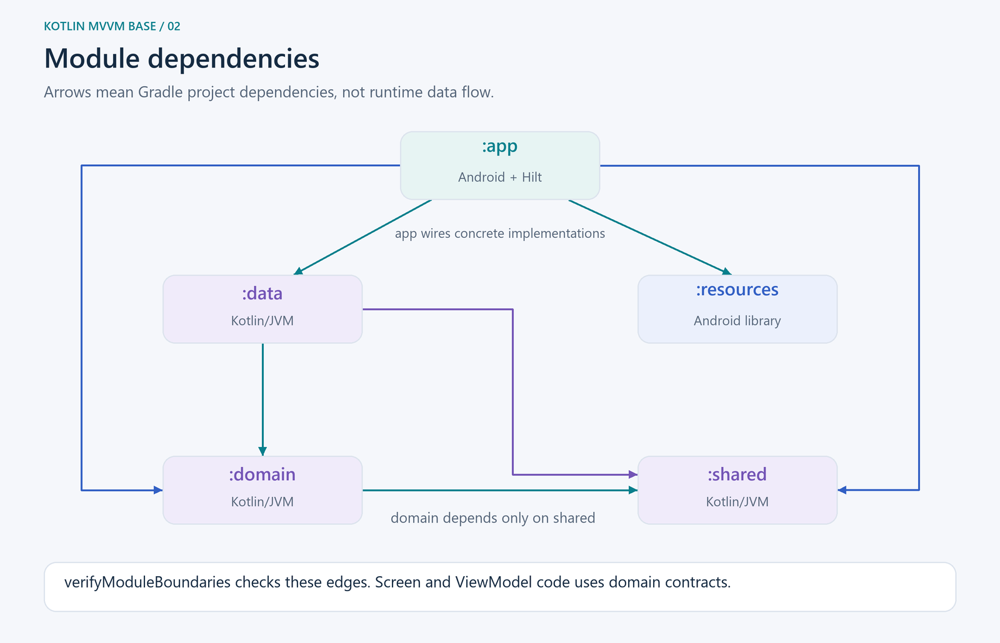
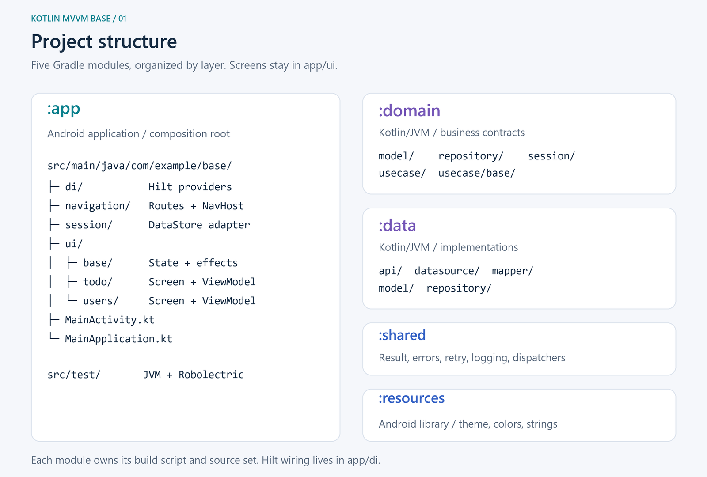
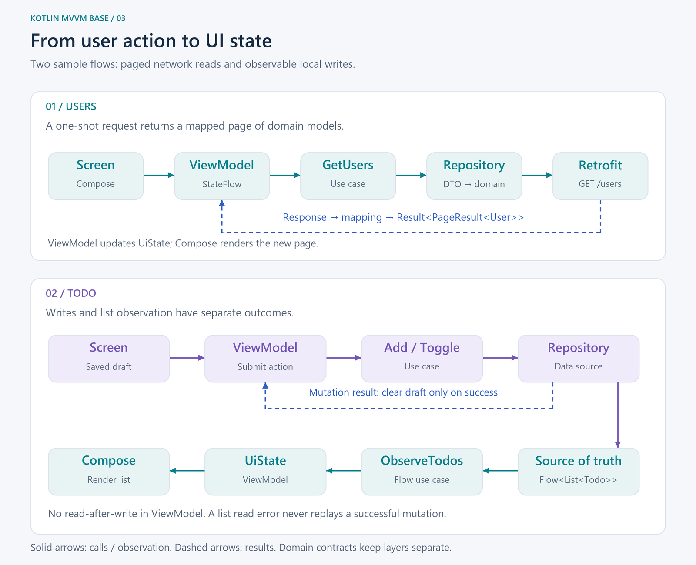
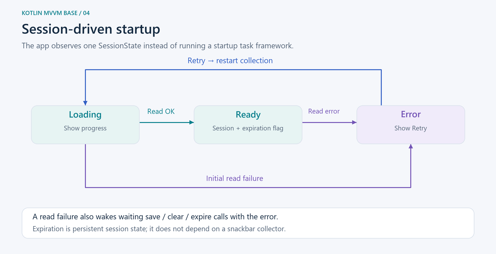

<p align="center">
  
</p>

<h1 align="center">Kotlin MVVM Base</h1>

<p align="center">
  An Android starter built around MVVM, Clean Architecture, and five Gradle modules.<br />
  Start with a working example. Keep the boundaries as your app grows.
</p>

<p align="center">
  <a href="https://kotlinlang.org/"></a>
  <a href="https://developer.android.com/compose"></a>
  <a href="https://dagger.dev/hilt/"></a>
  <a href="#architecture"></a>
  <a href="LICENSE"></a>
</p>

<p align="center">
  <strong>English</strong> · <a href="README.vi.md">Tiếng Việt</a> ·
  <a href="docs/architecture.md">Architecture guide</a> ·
  <a href="CONTRIBUTING.md">Contributing</a>
</p>

## Why this base?

The useful part of a starter is the set of decisions you can carry into your next project:
where business rules live, how dependencies are wired, what owns screen state, and how failures reach the UI.

This base makes those decisions visible through two small examples. **Users** demonstrates a paged Retrofit
request. **Todo** demonstrates observable local data, validation, mutations, and a saved draft.
Both use the same architecture without requiring a separate Gradle module for every screen.

The project takes inspiration from Flutter clean architecture bases and adapts the implementation to
Android: Hilt at the application boundary, lifecycle-scoped ViewModels, coroutines, and StateFlow.

## Contents

- [What is included](#what-is-included)
- [Getting started](#getting-started)
- [Architecture](#architecture)
- [Project structure](#project-structure)
- [Data flow](#data-flow)
- [Session and startup](#session-and-startup)
- [Tech stack](#tech-stack)
- [Using this as your base](#using-this-as-your-base)
- [Testing and verification](#testing-and-verification)
- [Scope and limitations](#scope-and-limitations)
- [Contributing](#contributing)
- [Acknowledgments](#acknowledgments)
- [License](#license)

## What is included

| Area | Implementation |
| --- | --- |
| Architecture | Five modules organized by layer; a Gradle task checks project dependency boundaries |
| Build variants | `devDebug`, `devRelease`, `prodDebug`, `prodRelease` via `environment` dimension & suffix isolation |
| Environment config | `AppConfig` / `AppEnvironment` validating API base URL and dynamically injected into Retrofit |
| Presentation | Compose, Material 3, destination-scoped ViewModels, lifecycle-aware state collection |
| Dependency injection | Hilt providers in `app/di`; domain and data stay independent of the DI framework |
| Domain | Entities, repository contracts, session contract, `BaseInput`/`BaseOutput` contracts, use case bases |
| Networking | Retrofit, OkHttp, Gson, DTO mapping, HTTP/body/JSON error handling |
| UI & Concurrency | `LoadingManager`, `ActionRunner`, RxDart-equivalent policies (`throttleFirst`, `droppable`, `sequential`, `debounceWithLatest`) |
| Todo sample | Observable in-memory source, synchronized writes, validation, `SavedStateHandle` draft |
| Users sample | Public JSONPlaceholder endpoint with `_page` / `_limit` pagination |
| Session | Preferences DataStore, atomic session snapshots, retryable restoration, persistent expiration |
| CI & Tests | GitHub Actions workflow, Kotlin/JUnit, coroutine tests (runTest), MockWebServer, and Robolectric |

## Getting started

### Requirements

- **JDK 21** for Gradle and the full test suite. Java/Kotlin bytecode targets JVM 17.
- Android Studio with Android SDK **34** and Build Tools **34.0.0** installed.
- An emulator or device running **Android 7.0 / API 24** or later to run the app.
- Internet access for the first dependency download and the Users sample.

The wrapper is Gradle **8.11.1**. Select **JDK 21** as the project's Gradle JDK; the IDE's bundled
runtime can be a different version. Machine-specific SDK/JDK paths belong in local configuration.

### Clone and build

```bash
git clone https://github.com/NguynNe3110/Kotlin-multi-module.git
cd Kotlin-multi-module
```

Open the root directory in Android Studio, configure the Gradle JDK, and sync the project.

**macOS / Linux**

```bash
chmod +x gradlew
./gradlew verifyModuleBoundaries :app:assembleDevDebug
```

**Windows / PowerShell**

```powershell
.\gradlew.bat verifyModuleBoundaries :app:assembleDevDebug
```

Run the `app` configuration with your chosen variant (`devDebug` recommended for local development).
The APK is generated at `app/build/outputs/apk/dev/debug/app-dev-debug.apk`.

The public API sample works without an API key. Todo data is kept in memory and resets when the process restarts.

## Architecture



Arrows represent **Gradle project dependencies**. MVVM describes the presentation layer;
Clean Architecture defines responsibilities; Gradle modules enforce the code boundaries.

| Module | Type | Owns | Project dependencies |
| --- | --- | --- | --- |
| [`app`](app) | Android application | Screens, ViewModels, navigation, Android session adapter, Hilt wiring | `domain`, `data`, `shared`, `resources` |
| [`domain`](domain) | Kotlin/JVM | Models, repository/session contracts, use cases | `shared` |
| [`data`](data) | Kotlin/JVM | Repository implementations, API services, DTOs, mappers, data sources | `domain`, `shared` |
| [`shared`](shared) | Kotlin/JVM | Result, error types, logging, retry, dispatchers | — |
| [`resources`](resources) | Android library | Theme, colors, strings | — |

`app` references `data` to wire concrete implementations through Hilt. Screens and ViewModels consume domain
contracts. `domain` does not know about Compose, NavController, DataStore, Retrofit, or Hilt.

`verifyModuleBoundaries` validates allowed project dependencies, including dependencies in test configurations.
It also runs with each module's `check` task. The UI-to-domain rule inside `app` remains a code convention.

Read the [architecture guide](docs/architecture.md) for the loading, effect, error, and repository contracts.

## Project structure



```text
Kotlin-multi-module/
├── app/                   # Android app, presentation, Hilt composition root
├── domain/                # Business models, contracts, use cases
├── data/                  # Repository implementations and data access
├── shared/                # Kotlin primitives and utilities
├── resources/             # Android theme and resources
├── gradle/                # Wrapper and version catalog
├── docs/                  # Architecture, testing, GitHub metadata, images
└── tools/docs/            # Reproducible SVG/PNG diagram generator
```

Source packages use `com.example.base`. The Todo and Users screens live in `app/ui/`.
This base keeps a **layer-based module structure** as new screens are added.

## Data flow



### Users: a paged network read

`UsersScreen` calls `UsersViewModel`, which invokes `GetUsersUseCase`. The repository calls the Retrofit
service, maps DTOs to domain models, and returns a `Result<PageResult<User>>`. The ViewModel updates
`UsersUiState`, and Compose renders the current page.

### Todo: writes and observation

`ObserveTodosUseCase` observes `TodoRepository.getTodosFlow()`. Successful add/toggle operations update the
source of truth, and the list reaches the screen through Flow. There is no read-after-write in the ViewModel.

The write result and the observation result stay independent: a failed list read does not turn an already
successful add into a failed mutation. The draft is cleared only after an add succeeds, and a newer draft typed
while the request was running is preserved.

### Loading, effects, and retry

- Screen state is exposed through StateFlow and collected with `collectAsStateWithLifecycle()`.
- `BaseScreen` handles pending snackbar/dialog/navigation effects while the lifecycle is STARTED.
- Effects stay in the ViewModel until the UI acknowledges their IDs. They survive rotation with the ViewModel.
- Loading is counted by `LoadingKey`, so overlapping operations do not hide each other's indicators.
- Replay requires `allowRetry = true` **and** a retryable failure. Mutations use the default of no replay.
- Cancellation is propagated through repository helpers, retry, and use case bases.

## Session and startup



The root screen observes `SessionManager.state`: **Loading** shows progress, **Ready** opens the app,
and **Error** offers Retry. This keeps startup tied to the one resource it needs: the restored session.

The Android adapter lives in `app/session`; its contract lives in `domain/session`.
Late DataStore read failures also reach pending `save`, `clear`, and `expire` calls.
Expiration is persisted and observed by navigation, independently of presentation effects.

## Tech stack

These are the versions declared in the [version catalog](gradle/libs.versions.toml).
Gradle can resolve higher AndroidX versions through transitive dependencies.

| Purpose | Technology |
| --- | --- |
| Language | Kotlin **1.9.23** |
| UI | Jetpack Compose, Material 3; BOM **2024.03.00** |
| DI | Hilt **2.51.1** |
| Async / state | Coroutines and StateFlow **1.8.0** |
| Navigation | Navigation Compose **2.8.9** |
| Networking | Retrofit **2.11.0**, OkHttp **4.12.0**, Gson **2.11.0** |
| Preferences | DataStore **1.1.1** |
| Testing | Kotlin/JUnit, coroutine test, MockWebServer, Robolectric **4.16.1** |
| Build | AGP **8.3.1**, Gradle **8.11.1**, Kotlin DSL, version catalog |

## Using this as your base

1. **Fork or copy the project.** Keep the [license notice](LICENSE) with the reused code.
2. **Rename the application.** Update `applicationId`, Android namespaces, Kotlin packages, app name,
   and `rootProject.name`. The current package prefix is `com.example.base`.
3. **Replace the examples.** Add your domain contracts and use cases, then implement repositories in `data`.
4. **Wire dependencies in `app/di`.** Keep framework-specific provider code at the composition root.
5. **Add screens under `app/ui`.** Register routes in `app/navigation` and obtain each ViewModel in its destination.
6. **Add application-specific infrastructure.** Configure endpoints, storage, authentication, signing,
   and release settings to match your product.

See [adding a screen](docs/architecture.md#adding-a-screen) for the recommended order and source references.

## Testing and verification

```bash
./gradlew verifyModuleBoundaries
./gradlew :domain:test :data:test :shared:test
./gradlew :app:testDevDebugUnitTest :app:testProdDebugUnitTest
./gradlew :app:assembleDevDebug :app:assembleProdDebug
```

On Windows, use `.\gradlew.bat` with the same tasks.

The current local validation on JDK 21 has **103 passing tests** across all modules (17 domain, 7 data, 33 shared, 46 app), a successful build across `devDebug` and `prodDebug` variants, verified module boundaries, and CI automation via GitHub Actions (`.github/workflows/ci.yml`).

Read [testing and verification](docs/testing.md) for variant details, coverage, report paths, and the remaining validation limits.

## Scope and limitations

This is a reusable starting point with small examples. Product-specific backend integration remains to be added.

- The Login destination is a placeholder. There is no sign-in service or token-refresh coordinator.
- Preferences DataStore is not encrypted. Credential encryption and authentication policy need a product-specific implementation.
- The public JSONPlaceholder client does not attach session tokens.
- Todo data is in memory. A persistent repository must implement the same observable source-of-truth contract.
- Pending UI effects are held in ViewModel memory; process-death persistence is not implemented for effects.
- Compile/target SDK is 34. Dependency and SDK upgrades should be reviewed before release distribution.
- Device testing, instrumented UI tests, and runtime profiling have not been completed for this base.

## Contributing

Bug reports, small fixes, tests, and documentation improvements are welcome.
Read [CONTRIBUTING.md](CONTRIBUTING.md) before opening a pull request.
Changes are recorded in [CHANGELOG.md](CHANGELOG.md).

## Acknowledgments

Architecture and documentation inspiration:

- [Android Showcase](https://github.com/igorwojda/android-showcase) by Igor Wojda.
- [Flutter Bloc Clean Architecture](https://github.com/ntminhdn/Flutter-Bloc-CleanArchitecture) and the NALS Engineering tutorials.

The diagrams in this repository are generated from [their source script](tools/docs/generate_diagrams.py).
PNG files are embedded for consistent viewing; editable SVGs are included alongside them.

## License

[MIT License](LICENSE) · Copyright © 2026 [NguyenUzuu](https://github.com/NguynNe3110).

Third-party libraries retain their respective licenses.
# Lets-Play
