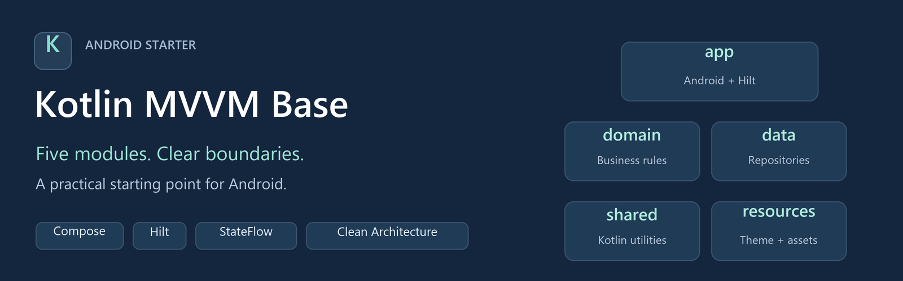
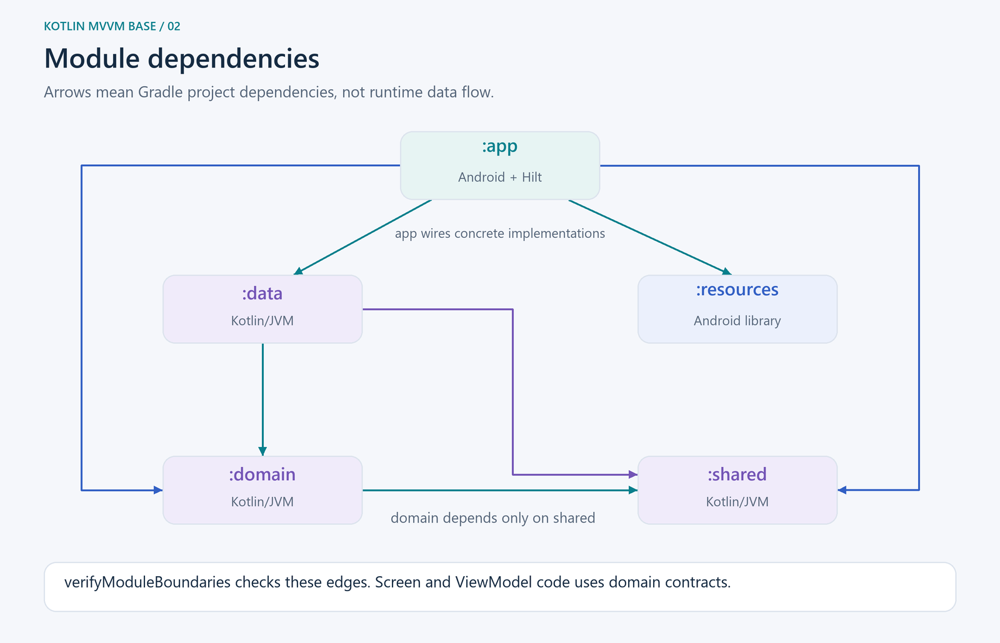
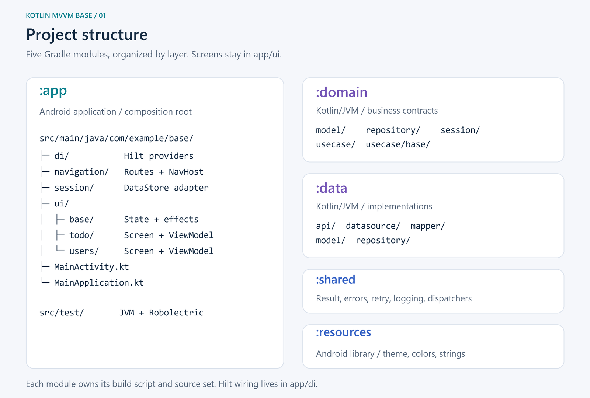
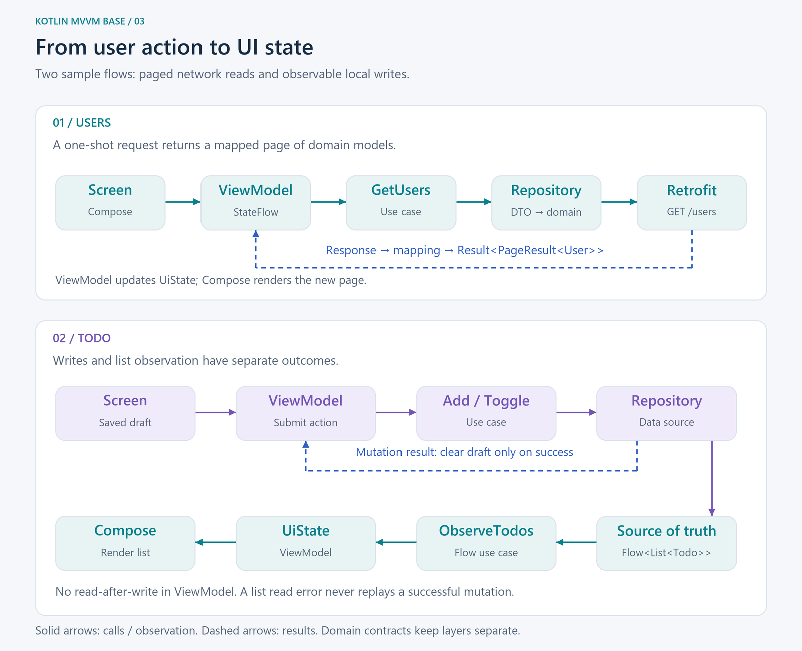
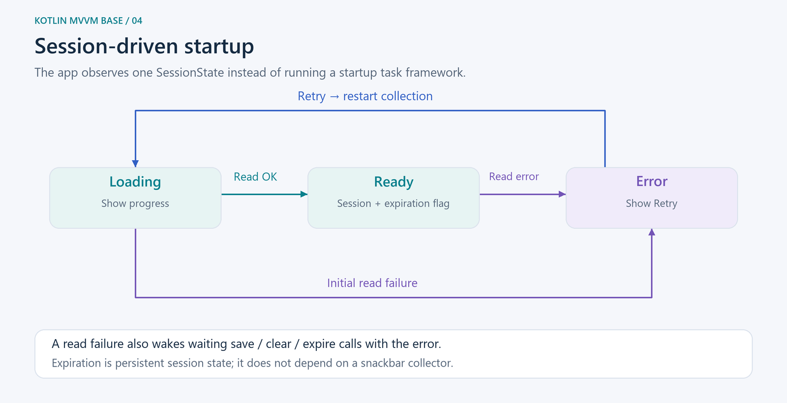

<p align="center">
  
</p>

<h1 align="center">Kotlin MVVM Base</h1>

<p align="center">
  Base Android dùng MVVM, Clean Architecture và năm Gradle module chia theo layer.<br />
  Có ví dụ chạy được để bắt đầu, có ranh giới rõ ràng để phát triển tiếp.
</p>

<p align="center">
  <a href="README.md">English</a> · <strong>Tiếng Việt</strong> ·
  <a href="docs/architecture.md">Hướng dẫn kiến trúc</a> ·
  <a href="CONTRIBUTING.md">Đóng góp</a> · <a href="LICENSE">MIT License</a>
</p>

## Base này giải quyết điều gì?

Khi bắt đầu một ứng dụng, những quyết định quan trọng thường nằm ở cách chia trách nhiệm:
nghiệp vụ ở đâu, ViewModel giữ state thế nào, repository trả lỗi ra sao, và Hilt nối các phần lại như thế nào.

Base này thể hiện những quyết định đó qua hai ví dụ nhỏ:

- **Users:** gọi Retrofit, chuyển DTO thành domain model, phân trang bằng `_page` / `_limit`.
- **Todo:** quan sát dữ liệu qua Flow, thêm/toggle, validation và khôi phục bản nháp.

Dự án lấy cảm hứng từ các base Flutter Clean Architecture, với cách triển khai phù hợp Android:
Hilt ở app, ViewModel theo lifecycle, coroutine và StateFlow.

## Mục lục

- [Những gì đã có](#những-gì-đã-có)
- [Bắt đầu](#bắt-đầu)
- [Kiến trúc](#kiến-trúc)
- [Cấu trúc project](#cấu-trúc-project)
- [Luồng dữ liệu](#luồng-dữ-liệu)
- [Session và khởi động](#session-và-khởi-động)
- [Dùng làm base cho dự án mới](#dùng-làm-base-cho-dự-án-mới)
- [Kiểm tra](#kiểm-tra)
- [Phạm vi hiện tại](#phạm-vi-hiện-tại)
- [Đóng góp và license](#đóng-góp-và-license)

## Những gì đã có

| Thành phần | Cách triển khai |
| --- | --- |
| Kiến trúc | 5 module theo layer; Gradle kiểm tra chiều phụ thuộc giữa các module |
| Build variants | `devDebug`, `devRelease`, `prodDebug`, `prodRelease` qua dimension `environment` và hậu tố app ID |
| Môi trường & Config | `AppConfig` / `AppEnvironment` validate API base URL, inject động vào Retrofit |
| UI | Jetpack Compose, Material 3, lifecycle-aware state collection |
| MVVM | ViewModel theo destination, StateFlow cho UiState, SavedStateHandle cho bản nháp |
| DI | Hilt tại `app/di`, domain và data độc lập DI framework |
| Nghiệp vụ | Entity, repository/session contract, `BaseInput`/`BaseOutput` contracts, use case suspend/Flow/sync/paging |
| Network | Retrofit, OkHttp, Gson, DTO mapper và chuẩn hóa lỗi HTTP/JSON/body |
| UI & Concurrency | `LoadingManager`, `ActionRunner`, Flow policies tương đương RxDart (`throttleFirst`, `droppable`, `sequential`, `debounceWithLatest`) |
| Session | Preferences DataStore, snapshot nguyên tử, Retry khi đọc lỗi, lưu trạng thái hết phiên |
| CI & Kiểm thử | GitHub Actions workflow, Kotlin/JUnit, coroutine test (runTest), MockWebServer, Robolectric |

Các phiên bản khai báo hiện tại: Kotlin **1.9.23**, Hilt **2.51.1**, Coroutines **1.8.0**,
Retrofit **2.11.0**, Navigation Compose **2.8.9**, Gradle **8.11.1**, AGP **8.3.1**.
Xem [version catalog](gradle/libs.versions.toml) để biết toàn bộ dependency.
Gradle có thể resolve phiên bản AndroidX cao hơn qua dependency bắc cầu.

## Bắt đầu

### Yêu cầu

- **JDK 21** để chạy Gradle và toàn bộ test; bytecode vẫn target JVM 17.
- Android Studio, Android SDK **34**, Build Tools **34.0.0**.
- Emulator hoặc thiết bị Android **API 24** trở lên để chạy app.
- Internet cho lần tải dependency đầu tiên và màn Users.

Chọn **Gradle JDK = 21** trong cấu hình project của Android Studio. JDK chạy Gradle
có thể khác runtime dùng để mở IDE. Cấu hình SDK/JDK theo máy không đưa vào Git.

### Clone và build

```bash
git clone https://github.com/NguynNe3110/Kotlin-multi-module.git
cd Kotlin-multi-module
```

Mở thư mục gốc trong Android Studio, cấu hình JDK, sync rồi chạy cấu hình `app` theo variant mong muốn (khuyên dùng `devDebug` khi phát triển local).

**Windows / PowerShell**

```powershell
.\gradlew.bat verifyModuleBoundaries :app:assembleDevDebug
```

**macOS / Linux**

```bash
chmod +x gradlew
./gradlew verifyModuleBoundaries :app:assembleDevDebug
```

APK nằm ở `app/build/outputs/apk/dev/debug/app-dev-debug.apk`.
API mẫu không cần key. Todo lưu trong bộ nhớ, nên dữ liệu sẽ reset khi process khởi động lại.

## Kiến trúc



Mũi tên trong hình là **project dependency của Gradle**.
MVVM tổ chức tầng presentation; Clean Architecture chia trách nhiệm; Gradle module tạo ranh giới biên dịch.

| Module | Loại | Trách nhiệm | Phụ thuộc |
| --- | --- | --- | --- |
| [`app`](app) | Android application | Compose, ViewModel, navigation, Android session adapter, Hilt wiring | `domain`, `data`, `shared`, `resources` |
| [`domain`](domain) | Kotlin/JVM | Model nghiệp vụ, repository/session contract, use case | `shared` |
| [`data`](data) | Kotlin/JVM | Repository implementation, API, DTO, mapper, data source | `domain`, `shared` |
| [`shared`](shared) | Kotlin/JVM | Result, lỗi, retry, logging, dispatchers | Không có |
| [`resources`](resources) | Android library | Theme, màu, chuỗi | Không có |

`app` tham chiếu `data` để Hilt lắp ghép implementation. Screen/ViewModel dùng contract và use case của domain.
Domain không phụ thuộc Compose, NavController, DataStore, Retrofit hoặc Hilt.

Task `verifyModuleBoundaries` kiểm tra project dependency, bao gồm cấu hình test, và chạy cùng `check`.
Quy tắc Screen/ViewModel chỉ dùng domain trong nội bộ `app` vẫn là quy ước khi viết/review code.

## Cấu trúc project



```text
Kotlin-multi-module/
├── app/                   # Android, presentation, Hilt composition root
├── domain/                # Nghiệp vụ và contract
├── data/                  # Truy cập dữ liệu và implementation
├── shared/                # Thành phần Kotlin dùng chung
├── resources/             # Theme và tài nguyên Android
├── gradle/                # Wrapper, version catalog
├── docs/                  # Hướng dẫn, sơ đồ, cấu hình giới thiệu GitHub
└── tools/docs/            # Script tạo lại SVG/PNG
```

Package hiện dùng tiền tố `com.example.base`. Todo và Users là package trong `app/ui`.
Khi thêm màn hình, tiếp tục giữ cấu trúc module theo layer này.

## Luồng dữ liệu



### Users: đọc dữ liệu phân trang

`UsersScreen → UsersViewModel → GetUsersUseCase → UserRepositoryImpl → Retrofit`.
Repository chuyển DTO thành domain model và trả `Result<PageResult<User>>`.
ViewModel cập nhật `UsersUiState`; Compose hiển thị state mới.

### Todo: tách ghi và quan sát

`ObserveTodosUseCase` quan sát `TodoRepository.getTodosFlow()` để cập nhật danh sách.
Khi thêm/toggle thành công, repository cập nhật source of truth và Flow phát danh sách mới.
ViewModel không gọi tải lại sau từng mutation.

Kết quả ghi và lỗi đọc danh sách được xử lý riêng. Ghi đã thành công sẽ không bị biến thành lỗi mutation
chỉ vì observation thất bại sau đó. Nút Retry của danh sách chỉ khởi động lại việc quan sát.

Bản nháp nằm trong `SavedStateHandle`. Chỉ xóa sau khi thêm thành công và nội dung hiện tại vẫn là
bản đã gửi. Nếu thao tác thất bại hoặc người dùng đã nhập bản nháp mới, text được giữ lại.
Validation tiêu đề thuộc use case; UI kiểm tra để bật/tắt nút.

### State, effect và retry

- `StateFlow` chứa trạng thái màn hình, được collect bằng `collectAsStateWithLifecycle()`.
- `BaseScreen` xử lý effect khi lifecycle ở STARTED và xác nhận bằng ID sau khi xử lý.
- Effect chờ xử lý được giữ trong ViewModel qua rotation; chưa persist effect qua process death.
- `LoadingKey` đếm từng tác vụ, tránh một thao tác kết thúc làm ẩn loading của thao tác khác.
- Replay cần `allowRetry = true` và lỗi có `retryable = true`; mutation mặc định không replay.
- `CancellationException` được ném lại qua các helper, retry và use case.

## Session và khởi động



Màn hình gốc quan sát một `SessionManager.state`:

- `Loading`: đang đọc session, hiển thị tiến trình.
- `Ready(session, isExpired)`: đã có snapshot nhất quán, mở ứng dụng.
- `Error(cause)`: đọc lỗi, hiển thị nút Retry gọi `retryRestore()`.

Lỗi đọc DataStore sau khi đã Ready cũng được đưa vào state và truyền tới lệnh `save/clear/expire`
đang chờ. Retry tạo collection mới. Startup chỉ cần cơ chế khôi phục session này.

`expire()` xóa thông tin đăng nhập và persist trạng thái hết phiên. Navigation quan sát state để chuyển
về Login; thao tác này độc lập với snackbar. `save()` xóa trạng thái hết phiên khi đăng nhập thành công.

Chi tiết contract và source tham khảo nằm trong [hướng dẫn kiến trúc](docs/architecture.md).

## Dùng làm base cho dự án mới

1. Fork/copy project và giữ [license notice](LICENSE) của phần mã tái sử dụng.
2. Đổi `applicationId`, namespace Android, package Kotlin, tên app và `rootProject.name`.
3. Thay các mẫu Todo/Users bằng entity, contract và use case của sản phẩm.
4. Implement repository/data source ở `data`; khai báo provider Hilt tại `app/di`.
5. Thêm package màn hình ở `app/ui`, route ở `app/navigation`, lấy ViewModel ngay tại destination.
6. Cấu hình endpoint, storage, authentication, signing và release theo yêu cầu sản phẩm.

Xem [thứ tự thêm màn hình](docs/architecture.md#adding-a-screen) cùng liên kết đến file thực tế.

## Kiểm tra

```powershell
.\gradlew.bat verifyModuleBoundaries
.\gradlew.bat :domain:test :data:test :shared:test
.\gradlew.bat :app:testDevDebugUnitTest :app:testProdDebugUnitTest
.\gradlew.bat :app:assembleDevDebug :app:assembleProdDebug
```

Trên macOS/Linux, thay `.\gradlew.bat` bằng `./gradlew`.

Bản đã kiểm tra local bằng JDK 21 có **103 test qua** trên toàn bộ 4 module (17 domain, 7 data, 33 shared, 46 app), build thành công trên cả hai variant `devDebug` và `prodDebug`, và đã tích hợp CI workflow trên GitHub Actions (`.github/workflows/ci.yml`).
Xem [phạm vi kiểm thử và vị trí report](docs/testing.md).

## Phạm vi hiện tại

- Login là destination mẫu; chưa có backend đăng nhập hoặc refresh-token coordinator.
- Preferences DataStore chưa mã hóa credential; sản phẩm cần cơ chế bảo vệ token riêng.
- Client JSONPlaceholder công khai không gắn session token.
- Todo chưa lưu vào database; repository thật cần đáp ứng contract source of truth qua Flow.
- Compile/target SDK hiện là 34; cần xem xét cập nhật SDK/dependency trước khi phát hành.
- Chưa có kiểm thử thiết bị, instrumented UI test hoặc profiling để kết luận hiệu năng runtime.

## Đóng góp và license

Hướng dẫn đóng góp: [CONTRIBUTING.md](CONTRIBUTING.md). Ghi nhận thay đổi: [CHANGELOG.md](CHANGELOG.md).

Cảm hứng kiến trúc/tài liệu đến từ [Android Showcase](https://github.com/igorwojda/android-showcase)
và [Flutter Bloc Clean Architecture](https://github.com/ntminhdn/Flutter-Bloc-CleanArchitecture).
Các hình trong repo có [script tạo lại](tools/docs/generate_diagrams.py), kèm SVG để chỉnh sửa.

[MIT License](LICENSE) · Copyright © 2026 [NguyenUzuu](https://github.com/NguynNe3110).
Các thư viện bên thứ ba giữ license tương ứng của chúng.
