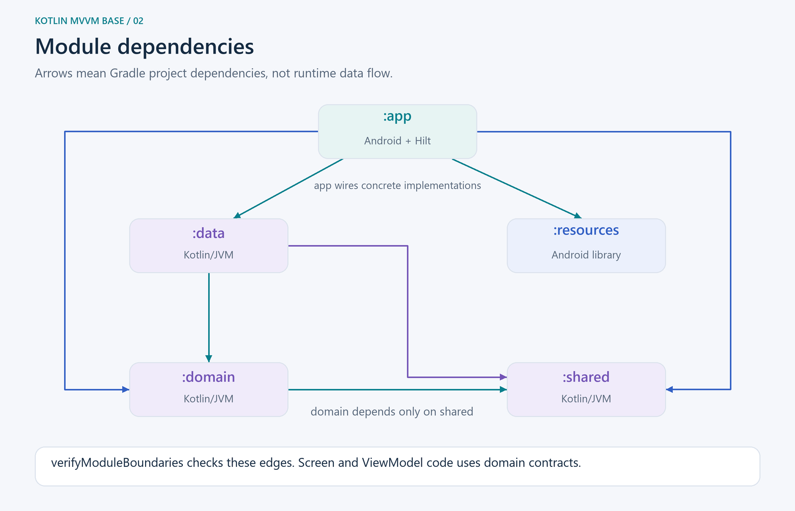

# Architecture guide

[Back to README](../README.md) · [Tiếng Việt](../README.vi.md) · [Testing](testing.md)

This guide describes the contracts behind the examples and the places to extend them.
The starter is an Android multi-module project organized by layer. Todo and Users are presentation packages
inside `app`, sharing domain and data modules.

## Boundaries



The module dependency rules are declared in the root [build script](../build.gradle.kts).
`verifyModuleBoundaries` inspects direct project dependencies across configurations, permits test dependencies
on the same module, and rejects project dependencies outside the allowlist.

The task does not inspect imports within `app`, or enforce every third-party library choice. Screens and
ViewModels should use domain contracts; imports of concrete data implementations belong in `app/di`.

`domain`, `data`, and `shared` are Kotlin/JVM modules. Android-specific persistence stays in `app/session`.
The `resources` module owns theme and Android resources. Navigation is presentation behavior and lives in `app`.

## Composition root

Hilt is applied to the Android application. The pure JVM classes are constructed by providers:

| File | Provides |
| --- | --- |
| [AppModule](../app/src/main/java/com/example/base/di/AppModule.kt) | Dispatcher provider, logger, application coroutine scope, session adapter/contract |
| [DataModule](../app/src/main/java/com/example/base/di/DataModule.kt) | AppConfig, Gson, error parser/mapper, environment-configured Retrofit service, data source, repository implementations |
| [DomainModule](../app/src/main/java/com/example/base/di/DomainModule.kt) | Observe/add/toggle Todo and paged Users use cases |

`MainApplication` is annotated with `@HiltAndroidApp`; `MainActivity` uses `@AndroidEntryPoint`.
Each navigation destination obtains its `@HiltViewModel` through `hiltViewModel()`.
ViewModel lifetimes follow the back stack entry.

## Environment and Build Variants

The build defines an `environment` flavor dimension with two flavors and two build types:

| Variant | Dimension / Flavor | Suffix | Application ID | Target Environment |
| --- | --- | --- | --- | --- |
| `devDebug` | `dev` | `.dev.debug` | `com.example.base.dev.debug` | Local development (`dev`) |
| `devRelease` | `dev` | `.dev` | `com.example.base.dev` | Staging / testing release (`dev`) |
| `prodDebug` | `prod` | `.debug` | `com.example.base.debug` | Production diagnostics (`prod`) |
| `prodRelease` | `prod` | (none) | `com.example.base` | Production release artifact (`prod`) |

`AppConfig` (`app/config/AppConfig.kt`) encapsulates the active `AppEnvironment` (`DEV` or `PROD`) and validates the API base URL (requiring valid HTTP/HTTPS scheme and trailing slash). It is read from Gradle `BuildConfig` and injected via Hilt into Retrofit in `DataModule`, preventing hardcoded network endpoints.

## Use case contracts

All base implementations live in [domain/usecase/base](../domain/src/main/java/com/example/base/domain/usecase/base). All input/output contracts derive from `BaseInput` and `BaseOutput`:

| Type | Contract Parameters | `execute` returns | Public call returns |
| --- | --- | --- | --- |
| `BaseUseCase<I, O>` | `I : BaseInput, O : BaseOutput` | `O` from a suspend function | `Result<O>` |
| `BaseNoInputUseCase<O>` | `O : BaseOutput` (uses `NoInput`) | `O` with `NoInput` | `Result<O>` through `useCase()` |
| `BaseSyncUseCase<I, O>` | `I : BaseInput, O : BaseOutput` | `O` synchronously | `Result<O>` |
| `BaseFlowUseCase<I, O>` | `I : BaseInput, O : BaseOutput` | `Flow<O>` | `Flow<Result<O>>` |
| `BasePagingUseCase<P, R>` | `P : PagingInput, R` | `PageResult<R>` | `Result<PageResult<R>>` |

Feature use cases use dedicated named data contracts:
- `AddTodoUseCase`: `AddTodoInput(title)` -> `AddTodoOutput(todo)`
- `GetTodosUseCase`: `NoInput` -> `GetTodosOutput(todos)`
- `ObserveTodosUseCase`: `NoInput` -> `ObserveTodosOutput(todos)`
- `ToggleTodoUseCase`: `ToggleTodoInput(id)` -> `ToggleTodoOutput(todo)`
- `GetUsersUseCase`: `GetUsersInput(page, pageSize)` -> `GetUsersOutput(users, page, pageSize, hasNext)`
Paging validates positive page/page-size values. Coroutine dispatchers are constructor parameters,
so tests can use a dispatcher tied to the test scheduler.

The suspend, sync, Flow, and retry helpers propagate `CancellationException`.
Flow creation occurs inside a Flow builder, so errors thrown while constructing the upstream are mapped
during collection as well.

## Repository contracts

Interfaces live in [domain/repository](../domain/src/main/java/com/example/base/domain/repository).
Implementations live in [data/repository](../data/src/main/java/com/example/base/data/repository).

- Repository methods return domain models, not DTOs or Retrofit `Response` objects.
- Technical failures are converted to the shared `Result.Failure` / `AppException` types.
- Use cases can call `getOrThrow()` to compose results; existing application exceptions keep their identity.
- DTO conversion is implemented in [data/mapper](../data/src/main/java/com/example/base/data/mapper).

### Observable Todo data

`TodoRepository.getTodosFlow()` is the observable source of truth. Successful writes must publish the committed
list through that Flow. The current implementation maps an in-memory data source to domain models and
serializes writes with a Mutex.

When replacing it with persistence or an API, keep the observable contract. A database Flow or a repository-owned
cache can publish committed values. Handle cache reconciliation in the repository instead of combining a mutation
and a new read into one ViewModel operation.

`ObserveTodosUseCase` converts the source to `Flow<Result<List<Todo>>>`.
`TodoViewModel.loadTodos()` starts or restarts observation. `addTodo()` and `toggleTodo()` only evaluate their
write results. A failed observation can be retried without repeating a committed write.

### Paged Users data

[JsonPlaceholderService](../data/src/main/java/com/example/base/data/api/JsonPlaceholderApi.kt) describes
the public `/users` endpoint. The repository checks the response body, maps DTOs, and creates a `PageResult`.
The sample's `hasNext` heuristic is `items.size == pageSize`; it can make one final request that returns no items.
Use backend pagination metadata when your API provides it.

The public Retrofit client is not authenticated. Add a separate client when a backend requires tokens,
and define refresh concurrency and replay semantics for that backend explicitly.

## UI state and drafts

Screens observe StateFlow with `collectAsStateWithLifecycle()`.
ViewModels expose the current state and handle user actions through functions.

[TodoViewModel](../app/src/main/java/com/example/base/ui/todo/TodoViewModel.kt) stores its draft in
`SavedStateHandle`. The draft is preserved with the ViewModel across rotation and participates in Android's
saved-state restoration. It is not a replacement for durable storage of user documents.

Submitting snapshots the current draft. Success clears it only if the current text still equals the submitted
text. A failed write or a newly edited draft stays intact. Business validation is implemented in `AddTodoUseCase`.

## Loading, concurrency policies, and presentation effects

The toolkit separates execution coordination from ViewModel inheritance:
- **`ActionRunner` & `LoadingManager`** (`shared/action`): Coordinates asynchronous operations, reference-counted loading tracking per `LoadingKey`, and opt-in mutation retry (`allowRetry = true`), completely independent of Android lifecycle or ViewModel.
- **Flow Policies** (`shared/flow`): Provides RxDart-equivalent reactive concurrency policies:
  - `throttleFirst(windowDurationMs)`: drops items arriving within window duration, emitting immediately on window expiration.
  - `droppable(scope, action)`: drops concurrent triggers while an execution is in progress.
  - `sequential(scope, action)`: serializes task execution in strict FIFO order with configurable buffer overflow strategy.
  - `debounceWithLatest(timeout, policy)`: debounces user inputs and applies latest-result semantics, supporting immediate task cancellation upon new keystrokes (`IMMEDIATE_ON_NEW_EMISSION`) or deferred cancellation (`AFTER_DEBOUNCE_TIMEOUT`).

[BaseViewModel](../app/src/main/java/com/example/base/ui/base/BaseViewModel.kt) provides convenience wrappers around `ActionRunner` and `LoadingManager`:
- `loadingKeys`: a reference count per `LoadingKey`. Counts are decremented in `finally`, including cancellation.
- `effects`: a StateFlow of pending `PendingUiEffect` items, each with an ID.

[BaseScreen](../app/src/main/java/com/example/base/ui/base/BaseScreen.kt) displays initial/submit loading,
observes effects while STARTED, and acknowledges each effect after it is handled. Dialog dismissal also
acknowledges the pending ID. Pagination uses screen state for its local indicator.

Effects remain queued while no screen is collecting. Rotation retains them with the ViewModel. The queue does
not persist across process death and is not an exactly-once durable event system.

Critical session invalidation is outside this queue. It updates persistent session state directly.

## Error presentation and retry

For an operation with an inline error state, use `showError = false` and update that state in `onFailure`.
For a transient operation error, let the default handler enqueue one presentation effect.
Do not also emit the same error manually in `onFailure` while default presentation is enabled.

```kotlin
launchOperation(
    key = LoadingKey.Initial,
    allowRetry = true,
    showError = false,
    action = { getUsersUseCase(GetUsersInput()) },
    onSuccess = { page ->
        _uiState.value = UsersUiState.Success(page.items, page.page, page.hasNext)
    },
    onFailure = { error -> _uiState.value = UsersUiState.Error(error) }
)
```

Operation replay defaults to disabled. With `allowRetry = true`, retry still requires a retryable exception.
`RetryConfig` controls the number of attempts and exponential backoff. A one-shot read can expose a manual
Retry action; the Users pagination sample retries via its Load more button against the latest state.
Do not opt a write into replay unless its behavior is safe to repeat under your backend contract.

## Session restoration

[SessionManager](../domain/src/main/java/com/example/base/domain/session/SessionManager.kt) exposes one state:

| State | Meaning | Root UI behavior |
| --- | --- | --- |
| `Loading` | Restoration is running | Progress indicator |
| `Ready(session, isExpired)` | Consistent snapshot, including an anonymous session | Create/show app navigation |
| `Error(cause)` | Reading failed or collection ended | Retry button |

[DataStoreSessionManager](../app/src/main/java/com/example/base/session/DataStoreSessionManager.kt) collects
preferences on the application scope. All fields of a session are published in one snapshot. Writes are
serialized; their waits observe both matching Ready snapshots and Error snapshots.

A read error after startup also becomes Error, so waiting writers fail instead of waiting on a dead collector.
`retryRestore()` starts a new collection. Healthy active collection ignores duplicate restore requests;
attempt IDs prevent older jobs from overwriting a newer attempt's state.

`save()` replaces optional token/user fields as well. `clear()` removes the session.
`expire()` removes credentials and persists the expiration flag. Navigation observes `Ready.isExpired`
and replaces the back stack with the Login destination.

Startup has no general task orchestrator: the root screen directly observes this session state.

## Navigation

[AppRoute](../app/src/main/java/com/example/base/navigation/AppRoute.kt) describes app destinations.
[AppNavigatorImpl](../app/src/main/java/com/example/base/navigation/AppNavigatorImpl.kt) adapts them to NavController.
Detail IDs are encoded with `Uri.encode` and read from navigation arguments, preserving spaces, plus signs,
slashes, and Unicode. Observers receive the decoded argument values.

The Login destination is a sample placeholder. Connect it to your authentication flow when adapting the base.

## Adding a screen

1. Add domain models and repository contracts if the new behavior needs them.
2. Add a use case for the business operation, using the appropriate suspend/Flow contract.
3. Implement the repository and mapping in `data`.
4. Register concrete dependencies in `app/di`.
5. Create `app/ui/<screen>/` with its Screen, ViewModel, and UiState.
6. Register the route and create the ViewModel in the navigation destination.
7. Add behavior tests and run the relevant [verification tasks](testing.md).

Use existing Todo and Users code as examples. Keep module changes tied to an actual responsibility or reuse need.
