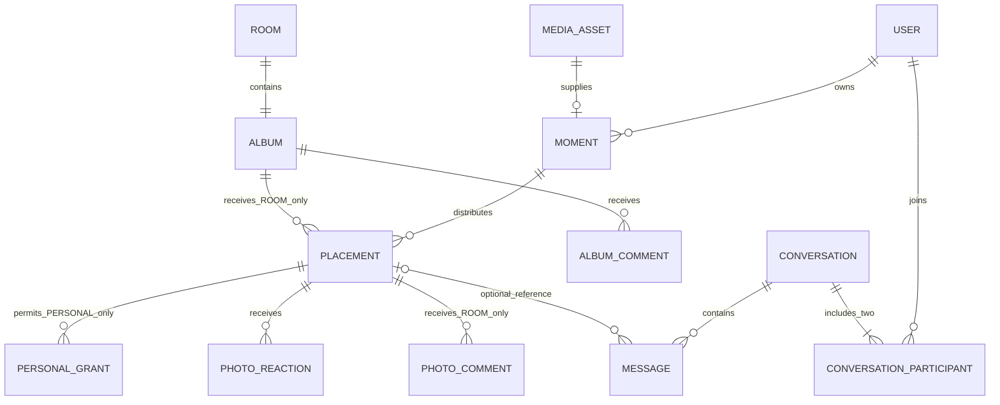

# Mô hình dữ liệu và hợp đồng đối tượng

> Cập nhật xác nhận 11/11/2026: đọc [delta BA PC-01–14, model/API, event và AC](../product-rules-2026-11-11.md) trước các baseline bên dưới. Trong phạm vi được liệt kê, delta thay quy tắc cũ mâu thuẫn về account, quyền host sửa ý, lịch đã chốt, nhập ảnh máy, lịch sử cho người mới, block trong album, duyệt tiền, former-member và đóng/lưu lịch sử phòng. Không suy ra endpoint đã có hoặc AC đã pass; các phần không bị thay thế vẫn giữ trạng thái xác nhận/đề xuất hiện có.

Đây là mô hình logic, không bắt buộc SQL/NoSQL hoặc nhà cung cấp cụ thể. Backend được đổi thiết kế vật lý nếu giữ nguyên bất biến, kết quả API và quyền tại [03](03-permissions-and-lifecycle.md). Tên field dùng camelCase trong JSON; enum dùng chữ hoa trừ planningPhase kế thừa.

## 1 Quy ước dữ liệu chung

| Kiểu | Quy ước |
| --- | --- |
| ID | String opaque ổn định do server cấp; ví dụ `mom_01` chỉ để đọc. Không suy quyền từ prefix, không dùng tên/chỉ số mảng |
| Mutation ID | UUID do client cấp cho một ý định tạo nội dung; không đổi khi retry cùng payload |
| Timestamp | RFC 3339 UTC có `Z`, precision millisecond; thời hạn tính theo duration thật, không cộng ngày theo múi giờ thiết bị |
| Timezone | IANA, baseline `Asia/Ho_Chi_Minh`; giờ hiển thị có timezone, không lưu `GMT+7` làm zone ID |
| Revision | Integer dương do server tăng khi tài nguyên quản lý thay đổi; dùng ETag/If-Match khi cập nhật |
| Text | Unicode NFC, trim hai đầu, plain text; chuẩn đếm code points tại 02 |
| Null | Dùng khi field được định nghĩa “không áp dụng”; không dùng chuỗi rỗng thay ID/thời gian |
| Missing | Request thiếu field khác null; unknown field bị từ chối 422, tránh client gửi owner hoặc trạng thái tùy ý |

Client không gửi `ownerId`, `authorId`, `roomRole`, `publishedAt`, `endedAt`, `effectiveWriteState`, `counts`, URL media hoặc trạng thái moderation để quyết định phía server. Các field này là server-managed.

## 2 Quan hệ logic

Một MediaAsset READY chưa publish có thể chưa có Moment. Một Moment có thể không còn placement ACTIVE nhưng vẫn có lịch sử nơi đăng REMOVED. Diagram không thể biểu diễn toàn bộ partial unique/ACL; ràng buộc bên dưới có hiệu lực cao hơn.

## 3 Các đối tượng phụ thuộc

| Đối tượng | Field tối thiểu cần từ service sở hữu | Trách nhiệm |
| --- | --- | --- |
| User | id, displayName, avatarRef, status | Identity bảo đảm stable ID và thu hồi phiên |
| Room | id, name, planningPhase kế thừa, currentPlanVersion, shortlistRevision, lifecycle, endedAt, timezone, revision, previousLifecycle/previousEndedAt khi ARCHIVED | Rooms thực thi lifecycle tại 03 và [kế hoạch liên tục](../continuous-planning.md); field version là delta đề xuất cần map backend |
| Membership | id, roomId, userId, role, status, joinedAt, leftAt | Unique một membership hiện hành mỗi room/user; tái tham gia không nhân đôi người |
| Friendship | userLowId, userHighId, status, relationshipRevision, sharingEpoch | Một cặp quan hệ; ACCEPTED mới được chia sẻ; epoch tăng đồng bộ khi hủy/chặn và không reset |
| Block | blockerId, blockedId, createdAt | Unique directed pair, cấm self-block |

Không cần frontend truy cập DB phụ thuộc. Authorize phải truy vấn nguồn hiện tại hoặc cache có cơ chế thu hồi theo NFR; ghi quan trọng phải kiểm nhất quán tại commit.

## 4 Album

| Field | Kiểu và nullable | Quy tắc |
| --- | --- | --- |
| id | ID, không null | PK |
| roomId | ID, không null | Unique; FK Room |
| postEndMode | VIEW_ONLY / OPEN / WINDOWED | Mặc định OPEN đề xuất; HOST cập nhật |
| windowHours | integer hoặc null | 1–720 khi WINDOWED, null ở mode khác |
| revision | integer | Tăng khi policy đổi; không tăng chỉ vì thời gian trôi qua |
| createdAt, updatedAt | Timestamp | Server |

Field tính động trong API: `effectiveWriteState`, `readOnlyReason`, `contributionDeadlineAt`, `serverTime`, `roomLifecycle`, `roomRevision`, `capabilities`, `visiblePhotoCount`, `visibleAlbumCommentCount`, `coverPlacement`. Không lưu cứng `canWrite=true` hoặc gộp count toàn cục rồi trả cho tất cả người xem. `coverPlacement` là ảnh mới nhất còn quyền trong tập chưa lọc theo màn; null nếu không có. Mở album không yêu cầu có ảnh.

## 5 MediaAsset và UploadSession

| Field | Kiểu | Quy tắc |
| --- | --- | --- |
| id, ownerId | ID | File thuộc user xin upload, không đổi |
| status | UPLOADING / PROCESSING / READY / FAILED / EXPIRED / PURGE_PENDING / PURGED | State machine tại 03 |
| source | CAMERA | Client khai báo nguồn; không hứa chứng minh ảnh chưa từng chỉnh sửa |
| contentType | image/jpeg | Client encode JPEG; kiểm MIME và magic bytes server |
| byteSize | integer | 1–10.485.760 byte (10 MiB) |
| storedByteSize | integer hoặc null | Bytes display + thumbnail thực giữ; tính quota sau xử lý, không nhân theo placements |
| declaredSha256, verifiedSha256 | lowercase hex 64 ký tự | Server xác minh bytes; sai là FAILED, không publish |
| capturedAt | Timestamp hoặc null | Thời gian thiết bị, không dùng làm deadline/order quyền |
| clientTimezone | IANA hoặc null | Metadata tham khảo, không thay room timezone |
| width, height | integer | Bản READY là vuông, cạnh 320–2.048 px, tối đa 4.194.304 pixel |
| storageOriginalKey, storageDisplayKey, storageThumbKey | private string | Nội bộ; không bao giờ trả raw key trong DTO |
| uploadExpiresAt | Timestamp | 15 phút sau cấp session; PUT hết hạn không tiếp nhận |
| processingDeadlineAt | Timestamp hoặc null | 120 giây từ complete; sau đó báo FAILED timeout |
| expiresAt | Timestamp | READY chưa gắn Moment được giữ 24 giờ từ READY; dọn nếu không publish |
| failureCode | enum hoặc null | CHECKSUM_MISMATCH, INVALID_IMAGE, UNSUPPORTED_FORMAT, PROCESSING_TIMEOUT, UPLOAD_EXPIRED |
| createdAt, readyAt, purgedAt | Timestamp, nullable theo state | Server |

Mỗi session cho một asset và một file; không upload chồng file sau complete. PUT có thể gửi lại cùng bytes khi session chưa complete/hết hạn. Complete nhiều lần chỉ đưa cùng asset vào processing một lần. Backend chỉ cấp preview ảnh cho owner nếu asset READY và chưa hết hạn; server xử lý lại ảnh, loại EXIF/GPS và tạo thumbnail trước READY.

Không nhận HEIC/PNG/WebP trong baseline; app encode ảnh camera sang JPEG trước upload. Đổi định dạng hoặc hỗ trợ camera roll cần sửa validation và AC, không chỉ thêm extension. Không có quyền thư viện/microphone bắt buộc cho chức năng này.

## 6 Moment

| Field | Kiểu | Quy tắc |
| --- | --- | --- |
| id, ownerId, mediaAssetId | ID | mediaAssetId unique một Moment, cùng owner, asset READY |
| caption | string 0–280 code points | Chuẩn hóa trước lưu; bất biến V1 |
| status | PUBLISHED / DELETED / HIDDEN_BY_MODERATION | Server managed |
| clientMutationId | UUID | Unique theo owner cho create Moment, giữ cùng payload fingerprint |
| revision | integer | Tăng khi thêm/gỡ placement, xóa hoặc moderation; reaction/comment không tăng revision Moment |
| publishedAt, createdAt | Timestamp | Cùng thời điểm transaction publish; không dùng capturedAt |
| deletedAt, hiddenAt | Timestamp hoặc null | Dùng cho logic/audit, không tự trả cho người không có quyền |

Một file asset không được publish thành nhiều Moment. Nếu client dùng mediaAssetId đã có Moment bằng một mutation ID khác, trả 409 `MEDIA_ALREADY_PUBLISHED` và owner có thể tra thao tác trước; không nhân bản. Upload lại cùng bytes là asset mới không tự gộp toàn hệ thống; không tìm trùng ảnh giữa người dùng.

## 7 Placement và quyền cá nhân

| Field | Kiểu | Quy tắc |
| --- | --- | --- |
| id, momentId | ID | PK và FK Moment |
| kind | PERSONAL / ROOM | Bất biến |
| albumId | ID hoặc null | ROOM bắt buộc, PERSONAL null |
| audienceMode | OWNER / ALL_FRIENDS_SNAPSHOT / SELECTED_FRIENDS hoặc null | PERSONAL bắt buộc; ROOM null |
| status | ACTIVE / REMOVED | REMOVED không restore |
| createdBy | ID | Chính owner Moment; host chỉ được remove |
| createdAt | Timestamp | Căn cứ order feed/album/tháng |
| removedAt, removedBy, removalReason | nullable | Audit quyền owner/host/moderator |

Ràng buộc database hoặc tương đương: unique `(momentId, kind)` **chỉ với ACTIVE**; ROOM albumId hợp lệ; PERSONAL không có albumId; grant chỉ tồn tại trên PERSONAL. Có thể tạo place mới cùng scope sau gỡ với ID mới. Thêm hai đích mới trong một command phải đồng thời hợp lệ, bao gồm constraint một room/place cá nhân.

`PersonalGrant`: `placementId`, `recipientUserId`, `sharingEpoch`, `state=ACTIVE/REVOKED`, `createdAt`, `revokedAt`, `revokedReason`. Unique placement/recipient. OWNER không có grant. Chỉ grants từ snapshot hợp lệ được tạo; không tạo row cho người không quen hoặc bị block. Grant không cấp quyền vào album. Grant ACTIVE nhưng epoch khác cặp hiện tại đã bị thu hồi về mặt logic, không chờ worker sửa state.

`AudienceSnapshot`: `id`, `ownerId`, `mode`, tập `{recipientUserId,sharingEpoch}`, `createdAt`, `expiresAt=createdAt+10 phút`. SELECTED có 1–200 recipient hợp lệ; ALL chụp toàn bộ bạn bè ACCEPTED không block, phải có 1–200 người. Nếu vượt 200, lỗi `AUDIENCE_LIMIT_EXCEEDED`, không cắt bớt âm thầm. Snapshot có thể dùng cho một command publish/add place; reuse cùng command retry hợp lệ, command khác không được tái sử dụng snapshot đã tiêu thụ. Nếu bất kỳ recipient mất điều kiện hoặc epoch đổi trước commit, lỗi `AUDIENCE_CHANGED`; bạn mới sau snapshot không tự được thêm.

## 8 Reaction và comment

Reaction enum baseline: `HEART` ❤️, `LAUGH` 😂, `WOW` 😮, `FIRE` 🔥, `SAD` 😢. Chuỗi emoji chỉ là render, payload gửi enum. Không hỗ trợ emoji tự do/action đặc biệt trong V1; từ “action” được cụ thể hóa thành các reaction này để ước lượng được.

| Entity | Field | Ràng buộc |
| --- | --- | --- |
| PhotoReaction | placementId, userId, type, revision, createdAt, updatedAt | Unique placement/user; PUT upsert, DELETE remove/tombstone nội bộ; count theo viewer |
| PhotoComment | id, placementId, authorId, text, state, clientMutationId, createdAt, deletedAt, deletedBy, removalReason | Chỉ ROOM; text 1–1.000; không parentCommentId ở V1 |
| AlbumComment | id, albumId, authorId, text, state, clientMutationId, createdAt, deletedAt, deletedBy, removalReason | Thread phẳng riêng, text 1–1.000 |

Comment create unique author/clientMutationId trong từng operation namespace; replay trả cùng ID. Xóa không đổi createdAt. GET known comment đã xóa chỉ trả `{id, state, text:null}` nếu còn quyền đọc parent; list bỏ comment đã xóa, count loại nó. Self-cleanup DELETE được sau mất parent access, nhưng không có GET ngoại lệ để đọc text.

Comment trong ảnh đã REMOVED không xuất hiện qua album comment hoặc một placement mới. Đây là lý do không chỉ gắn comment vào `momentId`.

## 9 Hội thoại và tin nhắn

| Entity | Field | Ràng buộc |
| --- | --- | --- |
| Conversation | id, userLowId, userHighId, lastSequence, createdAt, updatedAt | User sort theo ID canonical, unique cặp, userLowId khác userHighId |
| ConversationParticipant | conversationId, userId, lastReadSequence, lastDeliveredSequence | Chính xác hai người; watermark chỉ tăng, không vượt lastSequence |
| Message | id, conversationId, sequence, senderId, text, referencePlacementId nullable, state, clientMutationId, createdAt, recalledAt | sequence tăng riêng mỗi conversation, unique conversation/sequence; text 1–2.000; sender phải là participant |

Reference không lưu raw URL hoặc bản sao thumbnail có thể đọc vĩnh viễn. DTO trả reference dạng ACTIVE có media endpoint ngữ cảnh, hoặc UNAVAILABLE không có tác giả/caption/ảnh cache. Tin không reference vẫn hợp lệ. Message recall giữ ID và sequence, `text=null`, `reference=null`. Unread là số message SENT do người kia gửi có sequence lớn hơn lastReadSequence; không đếm tin tự gửi hoặc tin đã thu hồi. Inbox cập nhật count sau recall, delete user và read từ thiết bị khác.

Text không chỉnh sửa, không đính kèm file hoặc gửi ảnh mới trực tiếp trong DM V1. Muốn chia sẻ một ảnh chỉ riêng hai người, tạo PERSONAL SELECTED_FRIENDS cho người đó rồi gửi tham chiếu, không mở đường upload DM riêng.

## 10 Report và audit

`ContentReport`: id, reporterId, targetType `MOMENT/PLACEMENT/PHOTO_COMMENT/ALBUM_COMMENT/MESSAGE`, targetId, reason `HARASSMENT/INAPPROPRIATE/PRIVACY/SPAM/OTHER`, description 0–2.000 code points, status `OPEN/IN_REVIEW/RESOLVED/DISMISSED`, createdAt, resolvedAt. Reporter phải có quyền đọc target lúc gửi. MOMENT target chỉ dành owner hoặc moderator; người khác report qua PLACEMENT. Không tiết lộ reporter cho tác giả/host.

`AuditEntry` nội bộ: actorId/service, action, targetType/targetId, trước/sau các field policy/state cần thiết, reason, requestId, occurredAt. Không ghi token, URL có chữ ký, toàn bộ ảnh hoặc DM text vào application log. Evidence cần cho report dùng kho quyền hạn chế và TTL riêng.

`ContentMutation` nội bộ phục vụ receipt/tra cứu: actorId, operationName, clientMutationId, requestFingerprint, status `IN_PROGRESS/COMMITTED/REJECTED`, resourceIds, errorCode nullable, createdAt, committedAt nullable. Unique actor/operation/clientMutationId. Receipt COMMITTED được giữ cùng vòng đời nội dung/tombstone, gồm cả thao tác add placements; cache idempotency 24 giờ không được là cơ chế duy nhất chống tạo trùng. Receipt không lưu lại text/ảnh nhạy cảm để trả sau khi parent mất quyền. REJECTED/IN_PROGRESS lưu tối thiểu 24 giờ, worker phải resolve IN_PROGRESS bị treo thay vì giữ vô hạn.

## 11 DTO trả mobile

Các DTO bên dưới là allowlist. Không serialize entity DB nguyên vẹn. Optional field chỉ dùng khi ghi rõ; list và detail dùng cùng quy tắc loại ngữ cảnh khác.

| DTO | Field trả ra |
| --- | --- |
| UserRef | id, displayName, avatarUrl hoặc null; không email/phone/membership nội bộ |
| MomentSummary | id, caption, owner UserRef, publishedAt, capturedAt nullable, width, height, revision, media `{thumbnailPath,displayPath}` dùng route owner; chỉ owner |
| OwnedMomentDetail | MomentSummary + activePlacements `{id,kind,createdAt,roomNameAtPlacement nullable,albumId nullable,audienceMode nullable}`, capabilities quản lý; roomNameAtPlacement là snapshot tối thiểu, không metadata nhóm hiện tại sau rời |
| PlacementView | id, kind, createdAt, moment `{id,caption,owner,publishedAt,capturedAt,width,height}`, media `{thumbnailPath,displayPath}`, visibleReactionCounts, myReaction, visibleCommentCount, capabilities; ROOM thêm albumId, PERSONAL tuyệt đối không có room/album |
| AlbumView | id, room `{id,name,lifecycle,timezone,revision,endedAt}`, postEndPolicy `{mode,windowHours}`, revision, effectiveWriteState, readOnlyReason, contributionDeadlineAt, serverTime, visiblePhotoCount, visibleAlbumCommentCount, coverPlacement hoặc null, capabilities |
| CommentView | id, author UserRef hoặc null ở tombstone, text nullable, state, createdAt, capabilities `{canDelete,canRemoveAsHost}`; không include hidden author ở tombstone |
| ConversationView | id, peer UserRef, lastMessage preview an toàn hoặc null, unreadCount, lastReadSequence, canSend, sendDisabledReason nullable, updatedAt |
| MessageView | id, conversationId, sequence, sender UserRef, text nullable, state, createdAt, reference hoặc null, canRecall |

`PlacementView.capabilities`: `canReact`, `canRemoveMyReaction`, `canComment`, `canReplyPrivately`, `canRemovePlacement`, `canReport`. `canComment=false` cho PERSONAL. `AlbumView.capabilities`: `canContribute`, `canChangePolicy`, `canComment`, `canReportContent`. Capabilities là hỗ trợ UI, không thay kiểm tra mutation. `canReplyPrivately` còn false cho chính owner.

`visibleReactionCounts` luôn là object đủ năm key `{HEART:0,LAUGH:0,WOW:0,FIRE:0,SAD:0}` với integer không âm; `myReaction` là enum hoặc null. PERSONAL có `visibleCommentCount=0`, không dùng null để ngầm gợi có comment ẩn. `readOnlyReason` null khi OPEN, nếu READ_ONLY là `POST_END_VIEW_ONLY/POST_END_WINDOW_EXPIRED/ROOM_ARCHIVED`; UNAVAILABLE không trả AlbumView cho viewer. `coverPlacement` là `{id,thumbnailPath,owner:UserRef}` hoặc null, không chứa đường dẫn storage.

`reference` trong MessageView: `{state:"AVAILABLE",placementId,thumbnailPath}` hoặc `{state:"UNAVAILABLE",placementId}`; `placementId` là ID đã thuộc conversation, không dùng nó để tiết lộ lý do mất quyền. Inbox không embed thumbnail source; preview text ngắn tối đa 100 code points, bị thu hồi thì nhãn Tin nhắn đã thu hồi. Không đính kèm text DM trong push.

Mọi field capabilities là boolean; field nullable được trả null rõ ràng. `ConversationView.lastMessage` là `{id,sequence,state,senderId,textPreview}` hoặc null; textPreview null khi RECALLED. `updatedAt` dùng cho sort conversation là thời điểm message mới/recall, không đổi vì chỉ xem hoặc mark read. Participant đã xóa hiển thị UserRef với tên “Tài khoản đã xóa” và avatarUrl null, không trả danh tính đã xóa còn lưu trong evidence nội bộ.

## 12 Truy vấn và tính nhất quán

Backend cần cơ chế unique moment/media, active placement theo scope, membership room/user, reaction placement/user, friendship pair, conversation pair và sequence. Index gợi ý: album/status/createdAt/id, personal grant recipient/state/placement, moment owner/status/publishedAt/id, comment parent/state/createdAt/id, message conversation/sequence. Đây là mục tiêu truy vấn, không ép tên bảng/index.

Các list nội dung tạo mới cần creation watermark hoặc snapshot đọc nội bộ để phân trang không nhận item tạo sau trang đầu dù timestamp trùng millisecond. Watermark là cơ chế storage, không field do client cung cấp hay dùng làm public ID. Inbox thay đổi thứ tự theo message dùng reset/refetch khi event như 05.

Trang ảnh order `(placement.createdAt DESC, placement.id DESC)`; thư viện `(moment.publishedAt DESC, moment.id DESC)`; comment `(createdAt ASC,id ASC)`; tin nhắn `(sequence DESC)` khi tải lịch sử; app render tin theo sequence tăng. Múi giờ lọc tháng album dùng thời điểm thêm placement; thư viện dùng publishedAt theo timezone user gửi và được validate. Bounds tháng là `[đầu tháng, đầu tháng sau)`.

Counts và cover áp cùng ACL với list. Transaction publish/add place kiểm quyền hiện tại, constraint và snapshot consume rồi ghi outbox cùng commit. Không cho một request đã đọc membership cũ tiếp tục commit sau khi transaction remove member/đổi policy đã thắng.
