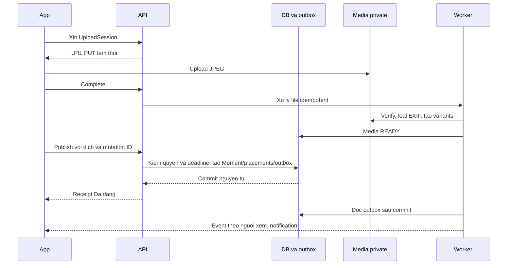

# Sự kiện thông báo và vận hành

> Cập nhật xác nhận 11/11/2026: đọc [delta BA PC-01–14, model/API, event và AC](../product-rules-2026-11-11.md) trước các baseline bên dưới. Trong phạm vi được liệt kê, delta thay quy tắc cũ mâu thuẫn về account, quyền host sửa ý, lịch đã chốt, nhập ảnh máy, lịch sử cho người mới, block trong album, duyệt tiền, former-member và đóng/lưu lịch sử phòng. Không suy ra endpoint đã có hoặc AC đã pass; các phần không bị thay thế vẫn giữ trạng thái xác nhận/đề xuất hiện có.

Các giá trị tải, retention và SLA trong tài liệu này là **mục tiêu đề xuất để backend review**, chưa phải kết quả benchmark hoặc cam kết đã có hạ tầng. Quy tắc quyền/deadline vẫn bắt buộc khi chọn baseline, không phụ thuộc push hoặc job hết hạn chạy đúng giờ.

## 1 Luồng xử lý và ranh giới commit



Outbox hoặc cơ chế tương đương phải bảo đảm không phát event trước commit và không mất effect cần đồng bộ khi process chết sau commit. Worker retry theo event ID; delivery là at least once, consumer deduplicate. Fanout lỗi không rollback post đã đăng, và post thành công không chờ toàn bộ push gửi xong.

## 2 Hợp đồng event

Envelope logic:

```json
{
  "eventId": "evt_01",
  "type": "album.post_end_policy.updated",
  "occurredAt": "2026-11-10T13:00:00.000Z",
  "resourceType": "ALBUM",
  "resourceId": "alb_01",
  "resourceRevision": 4,
  "payload": {"invalidate": ["album", "albumCapabilities"]}
}
```

Event là tín hiệu invalidate/refetch, không mang ảnh, URL storage, caption/comment/DM text hoặc danh sách người nhận toàn cục. ResourceRevision có thể null cho event watermark/derived-state không dùng revision entity; bắt buộc có eventId. User stream không được phát event nhóm cho bạn ngoài nhóm. Sự kiện thu hồi quyền cho chính người mất quyền chỉ chứa ID họ đã biết và yêu cầu dọn cache, không kèm thông tin mới của nhóm.

| Event | Khi phát | Người nhận hợp lệ | Hành vi consumer |
| --- | --- | --- | --- |
| moment.published | Publish commit | Owner | Bỏ optimistic draft, refetch thư viện, không tạo thêm post |
| placement.created | Place ACTIVE mới | Viewer còn quyền PERSONAL hoặc membership nhóm | Refetch feed/album; kiểm lại trước fanout |
| placement.removed | Gỡ place | Owner, các viewer từng được phát ID còn session phù hợp | Xóa cache place và source reference; refetch count/cover |
| moment.deleted / moment.hidden | Xóa/hide Moment | Owner và viewer từng nhận nội dung | Dọn media/DTO mọi place; reference thành unavailable |
| reaction.changed | PUT/DELETE reaction commit | Owner và viewer đang đọc đúng placement | Refetch counts/myReaction; không merge sang scope khác |
| photo_comment.created/deleted | Comment ảnh commit | Thành viên có quyền photo | Refetch comment/count; lọc block ở consumer/query |
| album_comment.created/deleted | Comment album commit | Thành viên có quyền album | Refetch thread chung, không nhảy vào ảnh |
| album.post_end_policy.updated | Host đổi policy commit | Membership ACTIVE | Refetch policy/deadline/capabilities |
| album.contribution_window.expired | Deadline trôi qua | Membership ACTIVE | Khóa CTA, refetch; resourceRevision có thể không đổi |
| room.lifecycle.changed | End/reopen/archive/restore/delete | Thành viên hiện hành; revoke event cho người đã biết | Refetch album; delete room thì dọn mọi group cache |
| membership.revoked | Leave/remove commit | User bị thu hồi và thiết bị của họ | Dọn group cache và ảnh tham chiếu, không nhận nội dung mới |
| friendship.changed / block.changed | Quan hệ đổi commit | Hai user liên quan, nội bộ authorize | Revoke grants/invalidate caches và reevaluate feed/DM |
| message.created / recalled | Commit message/recall | Hai participant, không host/nhóm | Upsert theo messageId/sequence; refetch reference có ACL |
| conversation.read/delivered | Watermark tăng | Thiết bị của participant tương ứng; đối phương được receipt tối thiểu | Không giảm watermark; sync unread |
| account.deleted/restricted | DEP-01 thay trạng thái | Thiết bị user và service liên quan | Thu hồi phiên, dọn dữ liệu local theo phạm vi |

Job hết hạn có thể chạy trễ và event có thể bị lặp. API vẫn tính effectiveWriteState từ serverTime mỗi request; app có timer dựa offset server nhưng mutation không tin timer này. Event cũ không được chuyển OPEN nếu API/policy mới đã khóa. Với event chỉ invalidate, fetch trạng thái mới thay vì ghi đè bằng payload cũ.

### 2.1 Đồng bộ sau mất kết nối

API logic bắt buộc `GET /me/photo-events?cursor=<opaque>&limit=100` trả `{items:Event[],nextCursor,hasMore,serverTime}` trong envelope chung. Limit default 100, max 200. Request đầu không cursor trả checkpoint hiện tại và items rỗng; client phải tải snapshot các màn đang mở, rồi đọc event từ checkpoint để bù race. Cursor thuộc user, giữ 7 ngày; quá hạn trả `410 EVENT_CURSOR_EXPIRED` và client full refetch + lấy checkpoint mới. User event order theo sequence trong stream, không lấy thứ tự network làm thứ tự nghiệp vụ.

WebSocket/SSE là lựa chọn transport để team kỹ thuật thống nhất; nếu chưa có, polling khi foreground mỗi 15 giây là fallback. Push chỉ đánh thức/làm người dùng biết, không phải event log. Resume/reconnect phải refetch trạng thái phòng/album, quyền source đang xem và unread trước cho ghi; không replay write offline tự động khi audience/policy có thể đổi.

## 3 Thông báo

| Sự kiện | In-app | Push mặc định đề xuất | Người nhận |
| --- | --- | --- | --- |
| Ảnh chia sẻ cá nhân | Có | Có nếu bật | Tập grant còn hiệu lực, bỏ người đăng |
| Ảnh thêm vào album | Có | Có nếu album không mute push | Thành viên ACTIVE còn thấy ảnh, bỏ người đăng |
| Reaction ảnh | Có, gộp theo place trong 60 giây | Gộp 60 giây | Owner còn đọc được đúng ngữ cảnh, bỏ tự reaction |
| Bình luận ảnh nhóm | Có | Có | Owner nếu còn đọc được ảnh; không gửi toàn nhóm từng comment |
| Bình luận album | Có | Có, có thể gộp 60 giây | Thành viên ACTIVE còn thấy comment, bỏ tác giả |
| Tin nhắn riêng | Có dưới unread conversation | Có nếu cho phép | Chính peer; không khi cặp đang block |
| Policy đổi hoặc album hết hạn | Có | Tắt mặc định | Thành viên ACTIVE, giải thích trạng thái mới khi mở |
| Gỡ nội dung bởi host/moderator | Có cho tác giả nếu tài khoản còn hợp lệ | Tắt mặc định | Chỉ tác giả; không công khai reason nhạy cảm cho nhóm |

Một Moment publish cả hai nơi có thể tạo hai placement event, nhưng notification **mỗi user một thông báo ảnh mới** cho cùng command. Ưu tiên deep link PERSONAL nếu user có grant đó; nếu không thì ROOM. Thông điệp trung tính “An vừa chia sẻ một khoảnh khắc”; không thêm tên phòng khi deep link cá nhân. Thêm place vào lần sau là command khác, được thông báo mới theo audience mới.

Worker kiểm lại quyền, block và preferences ngay trước gửi; không fanout bằng danh sách thành viên chụp từ nhiều phút trước. Thành viên mới không nhận toàn bộ notification lịch sử. Hủy/xóa đích trước fanout phải làm thông báo biến mất hoặc chuyển unavailable; deep link luôn kiểm server quyền hiện tại.

Push chứa thông điệp chung, resource ID opaque và type. Không gửi media, signed URL, caption, text comment/DM hoặc danh sách người nhận lên lock screen. Tắt quyền thông báo của OS không chặn đăng ảnh, đọc album hoặc đồng bộ unread. Logout phải unbind device token trước đổi user, token không được thuộc hai tài khoản hoạt động trên cùng cài đặt.

### 3.1 API in-app tối thiểu

- `GET /me/notifications?cursor&limit`: default 20/max 100, mới trước; trả `{id,type,createdAt,isRead,actor:UserRef|null,target:{type,id},availability}`. Target mất quyền trả UNAVAILABLE không tên/ảnh/text cũ.
- `PUT /me/notifications/{id}/read` body `{}`: idempotent, chỉ user nhận; đọc một notification không tự đánh dấu đã đọc DM.
- `PUT /me/notification-preferences` body gồm `photoPushEnabled`, `reactionPushEnabled`, `commentPushEnabled`, `messagePushEnabled` boolean; field không có giữ nguyên. Có GET cùng path để tải preference.
- `PUT /albums/{id}/my-notification-preference` body `{pushMuted:true|false}`: membership ACTIVE; chỉ mute push của user đó, không khóa album và không tắt in-app. GET cùng path trả preference hiện tại.

Mọi mutation dùng auth và Idempotency-Key theo 05. Inbox unread thuộc conversation, không nhân đôi vào notificationUnreadTotal cho mỗi message. Không tự mark read khi chỉ tải list hoặc nhận push.

## 4 Offline nháp và retry

Chụp offline lưu file trong vùng riêng app, gắn ownerUserId và context mong muốn; nhãn “Chưa đăng”. Nháp không nằm trong album/feed thật và không làm tăng count. Không hứa background upload bền vững trên mọi OS trong V1. Về foreground hiển thị nháp để tiếp tục, không tự gửi nếu chưa tái xác nhận người nhận đã thay đổi.

Nháp tự hết hạn sau 24 giờ từ chụp; app dọn khi có cơ hội chạy lần tiếp theo, không hứa xóa đúng giây khi OS đã kill. Trước hết hạn user được tiếp tục hoặc bỏ. Không lưu vào gallery công khai tự động. Logout/đổi tài khoản xóa nháp và cache của user cũ, không cho publish dưới owner mới; UI giải thích có ảnh chưa đăng trước logout.

Upload mất mạng nhưng session còn hạn có thể retry đúng bytes; checksum bảo đảm không thành ảnh khác. Asset READY server hết hạn 24 giờ nếu chưa gắn Moment; app có nháp gốc thì xin session mới sau user xác nhận. Sau publish timeout, giữ mutation ID và tra/ retry; không upload tạo Moment mới chỉ vì chưa nhận response.

Text comment/DM offline có thể lưu bản nhập local; nút gửi không báo thành công offline. Khi online gửi đúng ý định/key và kiểm quyền mới; không tự gửi hàng loạt hàng chờ sang một phòng đã kết thúc/khóa. Người dùng bấm Bỏ phải cancel hàng chờ local; nếu server đã commit thì dùng thao tác xóa/recall tương ứng, không gọi nó là hủy upload.

## 5 Media và bảo vệ quyền đọc

Mỗi request đọc mới qua gateway/API phải kiểm quyền hiện tại trước khi cấp bytes; không trả raw object public. Nếu cache/CDN, authorization vẫn chạy trước cache hit. URL media ngắn hạn hoặc token phải scope đúng variant/placement/user, TTL tối đa 60 giây, và vẫn có cơ chế từ chối request mới ngay sau thu hồi. Chỉ dựa vào “URL tự hết hạn” không đáp ứng điều kiện này.

Request đã bắt đầu trước thu hồi có thể hoàn tất; mục tiêu kết thúc quyền phục vụ/cached render trong 60 giây. App coi mọi nội dung server ngoài nháp có access lease tối đa 60 giây; khi hết lease mà offline/không xác minh được quyền, che nội dung đó đến khi kiểm lại. Foreground/refocus, event revoke, logout, block hoặc room deletion lập tức dọn view và cache liên quan. Có thể giữ binary cache mã hóa nhưng không được render khi lease không hợp lệ. Không hứa xóa ảnh đã được tải/chụp ngoài app.

Khi xử lý ảnh: kiểm kích thước byte, MIME/magic, decode với giới hạn bộ nhớ, checksum, orientation, crop vuông đã preview; re-encode để loại EXIF/GPS, tạo display ≤2.048 px và thumbnail 320 px, không phóng lớn ảnh 320px thành chất lượng giả. Temporary original không được expose; xóa chậm nhất 24 giờ sau xử lý thành công/thất bại. Không thu vị trí GPS hoặc danh bạ đầy đủ chỉ để chụp ảnh. Không dùng ảnh để nhận diện mặt hoặc AI nếu chưa có scope/đồng ý riêng.

## 6 Chỉ tiêu phi chức năng đề xuất

Tải tham chiếu để review: pilot 1.000 DAU, 200 user online đồng thời, phòng tối đa 30 membership ACTIVE, tối đa 200 bạn/người. Đây không phải số liệu người dùng hiện tại. Đo tại môi trường staging được mô tả rõ, media 1 MiB, RTT 100 ms, uplink 10 Mbps; tách thời gian mạng/upload khỏi API xử lý.

| Mã | Chỉ tiêu | Cách kiểm chứng |
| --- | --- | --- |
| NFR-01 | Không đọc/ghi chéo user/phòng, không lộ scope khác | Integration authorization và AC âm tính; gateway media kiểm cùng ACL |
| NFR-02 | Metadata read p95 ≤500 ms, write commit p95 ≤800 ms, không tính upload/processing | Load test tải tham chiếu, log latency theo operation |
| NFR-03 | Media processing p95 ≤10 giây, hard timeout 120 giây | Theo READY/FAILED từ complete, JPEG hợp lệ tại tải tham chiếu |
| NFR-04 | Commit đến foreground event p95 ≤3 giây với realtime; polling fallback ≤15 giây + latency | Đo event outbox lag và client receipt; không hứa push cùng SLA |
| NFR-05 | Metadata API availability mục tiêu 99,5% theo tháng | Synthetic check; upload/storage đo riêng, báo số thực |
| NFR-06 | Một ý định không sinh hai post/comment/message, kể cả retry sau process restart | Fault injection sau commit trước response; unique constraints |
| NFR-07 | Deadline chính xác theo server và race không vượt ACL | Clock boundary và concurrent policy/membership/publish tests |
| NFR-08 | Request mới mất quyền bị từ chối sau commit; cache đang có ngừng hiển thị trong 60 giây | Test hai thiết bị, media URL cũ, offline cache lease |
| NFR-09 | Giao diện list không load full album; limit tối đa 100 | Test 10.000 ảnh, keyset, memory và scroll mobile |
| NFR-10 | Text tiếng Việt, emoji không lỗi; font scale và screen reader dùng được | Test input normalize, font scale ≥150%, nhãn và focus |
| NFR-11 | Không log token, signed URL, ảnh hoặc text DM | Review payload logging, crash/analytics redaction |
| NFR-12 | Xóa logic ngay, purge có retry và quan sát được | Xóa Moment qua mọi endpoint; theo dõi purge queue/dead-letter |

## 7 Hạn mức và retention đề xuất

| Phạm vi | Giới hạn ban đầu để backend review | Khi vượt |
| --- | --- | --- |
| UploadSession | 30/giờ, 100/ngày/user; tối đa 3 asset đang UPLOADING/PROCESSING | 429 RATE_LIMITED và Retry-After |
| Publish/thêm place | 10/phút, 100/ngày/user; retry cùng key không tính thêm | 429; không publish nửa đích |
| Comment ảnh + album | 30/phút, 1.000/ngày/user tổng hai loại | 429 |
| Message | 60/phút, 2.000/ngày/user | 429 |
| Report | 5/giờ/user, dedup như 05 | 429 |
| Album | 10.000 ROOM placement ACTIVE | 409 ALBUM_CAPACITY_REACHED, vẫn đọc/xóa được |
| Dung lượng owner | 1 GiB media display+thumb đang giữ; reserve theo upload size rồi đối soát stored bytes | 429 STORAGE_QUOTA_EXCEEDED, không tính lại theo số nơi đăng |
| Media chưa publish | READY 24 giờ; session 15 phút; processing 120 giây | EXPIRED/FAILED, dọn orphan |
| Album/Moment đã đăng | Không tự hết hạn vì kết thúc kèo; giữ đến thao tác xóa/policy sau này | Không áp mốc 90 ngày của BA cũ cho album |
| Sau xóa | Logic ngay; mục tiêu purge primary ≤30 ngày, backup ≤90 ngày | Không khôi phục về nội dung công khai; backup replay phải áp deletion ledger |
| DM text và comment còn tồn tại | Giữ đến recall/xóa nội dung/account hoặc policy mới công bố | Không tuyên bố mã hóa đầu cuối hoặc lưu vĩnh viễn |
| Report/evidence, audit | Gợi ý 90 ngày sau xử lý report; audit tối thiểu 180 ngày không nội dung DM | Cần chủ sản phẩm/vận hành chốt tại D-12 trước production |

Giờ/phút rate limit dùng rolling window server; hạn mức ngày dùng UTC. API trả Retry-After theo số giây đến lúc có thể thử lại. Quota không tính asset đã purge; nếu xóa logic mà media chưa purge, backend phải giải thích phần pending cleanup, tránh hứa có dung lượng ngay khi chưa giải phóng. Không throttle DELETE/recall hợp lệ bằng quota tạo nội dung. Các con số cấu hình không phải xác nhận sản phẩm D-16.

## 8 Quan sát vận hành và chỉ số

Theo dõi upload complete/failed theo failureCode, thời gian processing, publish success/failure theo code, thời gian commit, outbox lag/retry, fanout dedup, số lỗi ACL, media requests sau revoke, orphan storage, purge lag và version conflict policy. Dùng requestId/mutationId để trace, không cần text/caption hoặc binary.

Analytics sản phẩm: `camera_opened`, `capture_completed`, `publish_attempted`, `publish_committed`, `album_viewed`, `album_contributed`, `photo_reacted`, `photo_commented`, `album_commented`, `private_reply_sent`, `album_policy_changed`. Thuộc tính tối thiểu scope, mode, result/errorCode và thời gian; không gửi text/ảnh/danh sách bạn. Một mutation chỉ tính một publish_committed. Các báo cáo cross-user dùng aggregate, không đưa về app danh tính ai xem ảnh vì V1 không có read receipt ảnh.

Backup restore phải replay deletion/revocation ledger trước khi phục vụ, không hồi sinh ảnh đã xóa hoặc grant bị hủy. Queue purge/event có dead-letter và cảnh báo; mất job hết hạn không được mở lại ghi. Kế hoạch recovery cần kiểm nghiệm trước cam kết SLA, không coi việc có tài liệu là đã có vận hành.
