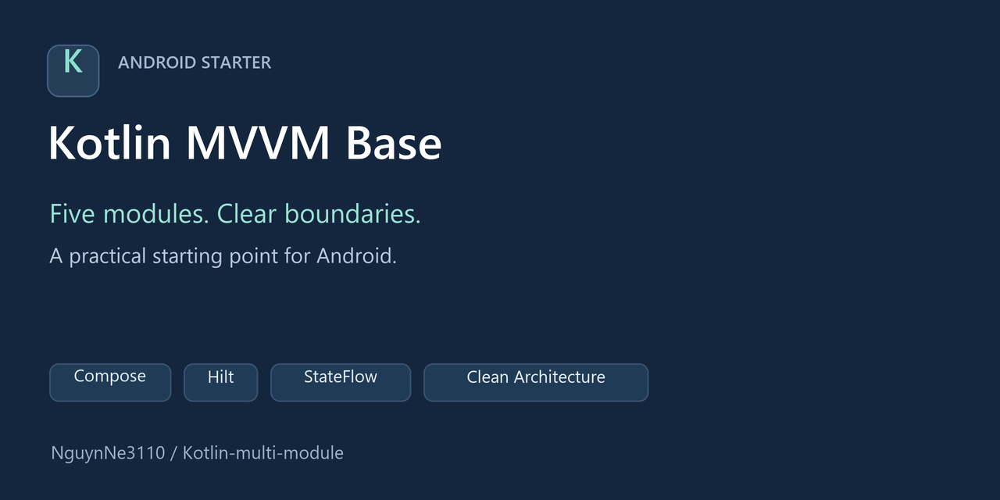

# GitHub repository metadata

[Back to README](../README.md)

Repository: [NguynNe3110/Kotlin-multi-module](https://github.com/NguynNe3110/Kotlin-multi-module)

## About description

```text
A Kotlin Android starter with MVVM, Clean Architecture, Jetpack Compose, Hilt, and five layer-based Gradle modules.
```

## Topics

```text
android
kotlin
mvvm
clean-architecture
multi-module
jetpack-compose
hilt
coroutines
stateflow
retrofit
android-template
boilerplate
```

These values can be applied with GitHub CLI by a repository admin:

```bash
gh repo edit NguynNe3110/Kotlin-multi-module \
  --description "A Kotlin Android starter with MVVM, Clean Architecture, Jetpack Compose, Hilt, and five layer-based Gradle modules." \
  --add-topic android,kotlin,mvvm,clean-architecture,multi-module,jetpack-compose,hilt,coroutines,stateflow,retrofit,android-template,boilerplate
```

The command changes repository metadata; it does not upload local source files or documentation.

## Social preview



The ready-to-upload PNG is [social-preview.png](images/social-preview.png), sized **1280 × 640**.
Its editable SVG is [social-preview.svg](images/social-preview.svg).

In repository **Settings → General → Social preview**, upload the PNG.
The image is an artwork asset, not a screenshot of an app screen.

## Repository template option

If you choose to distribute this repository as a GitHub template, enable **Template repository** in repository
settings. The current setup instructions use cloning/forking and do not depend on that setting.
