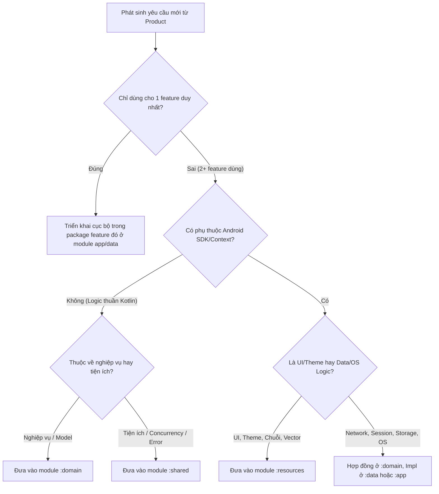

# Sổ tay Cải tiến Base theo Bài toán Sản phẩm (Product-Driven Evolution Playbook)

> **Mục đích:** Tài liệu này đóng vai trò hướng dẫn kỹ thuật (architectural playbook) cho các phiên bản tiếp theo của base khi ứng dụng bắt đầu phát triển các tính năng thực tế và va chạm với những bài toán hóc búa trong môi trường production.
>
> **Triết lý cốt lõi:** *"Không tối ưu hóa sớm khi chưa có nghiệp vụ (Premature Optimization is the root of all evil)."* Khi một bài toán sản phẩm thực tế phát sinh, đối chiếu tài liệu này để triển khai giải pháp chuẩn kiến trúc, giữ vững ranh giới 5 module (`app`, `domain`, `data`, `shared`, `resources`) mà không làm suy thoái mã nguồn.

---

## Mục lục

1. [Cây quyết định: Khi nào cần nâng cấp Base?](#1-cây-quyết-định-khi-nào-cần-nâng-cấp-base)
2. [Xác thực & Kết nối mạng (Auth & Network Resilience)](#2-xác-thực--kết-nối-mạng-auth--network-resilience)
   - [2.1. Cơn bão 401: Single-Flight Token Refresh Coordinator](#21-cơn-bão-401-single-flight-token-refresh-coordinator)
   - [2.2. Lắng nghe trạng thái mạng & Graceful Degradation](#22-lắng-nghe-trạng-thái-mạng--graceful-degradation)
   - [2.3. Upload/Download tệp lớn nền (WorkManager)](#23-uploaddownload-tệp-lớn-nền-workmanager)
3. [Lưu trữ Cục bộ & Offline-First (Persistence & Sync)](#3-lưu-trữ-cục-bộ--offline-first-persistence--sync)
   - [3.1. Tích hợp Room Database chuẩn Clean Architecture](#31-tích-hợp-room-database-chuẩn-clean-architecture)
   - [3.2. Chiến lược Cache: Stale-While-Revalidate](#32-chiến-lược-cache-stale-while-revalidate)
   - [3.3. Hàng đợi Sync Offline & Xử lý xung đột](#33-hàng-đợi-sync-offline--xử-lý-xung-đột)
   - [3.4. Chiến lược Room Database Migration](#34-chiến-lược-room-database-migration)
4. [Bảo mật Ứng dụng Thực tế (Production Security)](#4-bảo-mật-ứng-dụng-thực-tế-production-security)
   - [4.1. Mã hóa thông tin nhạy cảm qua Android KeyStore](#41-mã-hóa-thông-tin-nhạy-cảm-qua-android-keystore)
   - [4.2. SSL Pinning & Certificate Transparency](#42-ssl-pinning--certificate-transparency)
   - [4.3. Lọc dữ liệu nhạy cảm (PII Sanitization) trong Log & Crashlytics](#43-lọc-dữ-liệu-nhạy-cảm-pii-sanitization-trong-log--crashlytics)
5. [Tối ưu Hiệu năng & UI/UX (Performance & Polish)](#5-tối-ưu-hiệu-năng--uiux-performance--polish)
   - [5.1. Tối ưu thời gian khởi động app (Jetpack App Startup)](#51-tối-ưu-thời-gian-khởi-động-app-jetpack-app-startup)
   - [5.2. Tinh chỉnh Compose Recomposition & Danh sách lớn](#52-tinh-chỉnh-compose-recomposition--danh-sách-lớn)
   - [5.3. Pipeline hiển thị và Caching hình ảnh (Coil Integration)](#53-pipeline-hiển-thị-và-caching-hình-ảnh-coil-integration)
   - [5.4. Giám sát rò rỉ bộ nhớ (LeakCanary)](#54-giám-sát-rò-rỉ-bộ-nhớ-leakcanary)
6. [Khả năng Quan sát & Vận hành (Observability & Ops)](#6-khả-năng-quan-sát--vận-hành-observability--ops)
   - [6.1. Giám sát sự cố Crashlytics & Báo cáo lỗi Non-Fatal](#61-giám-sát-sự-cố-crashlytics--báo-cáo-lỗi-non-fatal)
   - [6.2. Trừu tượng hóa Analytics & Feature Flags (Remote Config)](#62-trừu-tượng-hóa-analytics--feature-flags-remote-config)
   - [6.3. Cơ chế Force Update & In-App Updates](#63-cơ-chế-force-update--in-app-updates)
7. [Quy trình Phát hành & CI/CD (Release Engineering)](#7-quy-trình-phát-hành--cicd-release-engineering)
   - [7.1. Tự động hóa ký Release APK/AAB qua CI Secrets](#71-tự-động-hóa-ký-release-apkaab-qua-ci-secrets)
   - [7.2. Tối ưu R8 / ProGuard Obfuscation & Consumer Rules](#72-tối-ưu-r8--proguard-obfuscation--consumer-rules)
8. [Bảng ma trận quy hoạch module khi mở rộng](#8-bảng-ma-trận-quy-hoạch-module-khi-mở-rộng)

---

## 1. Cây quyết định: Khi nào cần nâng cấp Base?

Trước khi bắt tay vào sửa code của base, hãy đối chiếu quy trình sau:



---

## 2. Xác thực & Kết nối mạng (Auth & Network Resilience)

### 2.1. Cơn bão 401: Single-Flight Token Refresh Coordinator

* **Triệu chứng thực tế:** Khi access token hết hạn, người dùng mở app khiến 5-10 API được gọi cùng lúc (Profile, Notification, Feed, Settings...). Nếu không xử lý, cả 10 request cùng nhận lỗi 401 và cùng lúc bắn 10 lệnh gọi `/refresh-token` lên server. Hậu quả: Backend huỷ session vì nghi ngờ tấn công (Token Replay), app bị văng ra màn hình đăng nhập vô cớ.
* **Giải pháp chuẩn:**
  1. Tạo `TokenRefreshCoordinator` tại `:data` sử dụng `kotlinx.coroutines.sync.Mutex`.
  2. Implement `okhttp3.Authenticator` hoặc OkHttp Interceptor.
  3. Khi request đầu tiên gặp 401, nó giữ lock của Mutex để thực hiện làm mới token. Các request 401 đến sau sẽ tạm dừng (suspend) chờ token mới mà không gọi thêm API refresh.
  4. Sau khi refresh thành công, lưu token mới vào `DataStoreSessionManager` và tự động replay lại tất cả các request đang chờ với header Authorization mới.
  5. Nếu refresh thất bại (Refresh token hết hạn vĩnh viễn): gọi `sessionManager.expire()` để chuyển app về màn hình Login một cách an toàn.

```kotlin
// Vị trí mẫu: data/src/main/java/com/example/base/data/network/TokenRefreshCoordinator.kt
class TokenRefreshCoordinator(
    private val sessionManager: SessionManager,
    private val authApi: Provider<AuthApi>,
    private val mutex: Mutex = Mutex()
) {
    suspend fun refreshTokenSingleFlight(currentToken: String): Result<String> {
        return mutex.withLock {
            val latestToken = sessionManager.getAccessToken()
            // Nếu token đã được một luồng khác refresh trước đó, dùng luôn
            if (latestToken != null && latestToken != currentToken) {
                return Result.Success(latestToken)
            }
            // Gọi refresh API
            try {
                val response = authApi.get().refreshToken(...)
                sessionManager.updateTokens(response.accessToken, response.refreshToken)
                Result.Success(response.accessToken)
            } catch (e: Exception) {
                sessionManager.expire()
                Result.Failure(AppException.SessionExpired(e))
            }
        }
    }
}
```

### 2.2. Lắng nghe trạng thái mạng & Graceful Degradation

* **Triệu chứng thực tế:** Người dùng đi vào thang máy, rớt mạng, bấm nút và màn hình chỉ xoay vòng hoặc báo lỗi kết nối khó chịu. Khi bước ra khỏi thang máy, app không tự phục hồi.
* **Giải pháp chuẩn:**
  * Tạo `NetworkConnectivityMonitor` trong `:shared` (hoặc bọc Android `ConnectivityManager.NetworkCallback` ở `:app` / `:data`).
  * Expose ra `Flow<NetworkStatus>` (`Available`, `Lost`, `Losing`).
  * ViewModel quan sát flow này: khi mạng quay trở lại (`Available`), tự động kích hoạt `ActionRunner.retry()` cho các tác vụ đang chờ nếu tác vụ đó có cờ `allowRetry = true`.
  * Tích hợp banner cảnh báo "Không có kết nối mạng" toàn cục trên `BaseScreenScaffold`.

### 2.3. Upload/Download tệp lớn nền (WorkManager)

* **Triệu chứng thực tế:** Upload video/ảnh 50MB hoặc tải file tài liệu. Người dùng chuyển app hoặc tắt màn hình -> Coroutine `viewModelScope` bị hủy, upload thất bại giữa chừng.
* **Giải pháp chuẩn:**
  * Không chạy tác vụ upload/download tệp lớn trong ViewModel scope hay Activity scope.
  * Tích hợp `androidx.work:work-runtime-ktx` và `androidx.hilt:hilt-work` tại module `:app`.
  * Tạo `CoroutineWorker` riêng biệt, sử dụng `Constraints.Builder().setRequiredNetworkType(NetworkType.CONNECTED)` để hệ điều hành tự quản lý việc chạy ngầm kể cả khi app bị tắt.

---

## 3. Lưu trữ Cục bộ & Offline-First (Persistence & Sync)

### 3.1. Tích hợp Room Database chuẩn Clean Architecture

* **Triệu chứng thực tế:** App cần khởi động tức thì, hiển thị dữ liệu ngay cả khi đang ngoại tuyến và đồng bộ ngầm khi có mạng (mô hình Single Source of Truth - SSOT).
* **Quy hoạch Module:**
  * **`:domain`:** Định nghĩa `Entity` thuần Kotlin và Repository Interface trả về `Flow<Data>`. Không chứa bất kỳ annotation `@Entity` hay `@Dao` nào của Room!
  * **`:data`:**
    * Chuyển đổi: Room cần dependencies `androidx.room:room-runtime` và `androidx.room:room-ktx`.
    * Khai báo `@Entity class RoomUserEntity(...)`.
    * Khai báo `@Dao interface UserDao { @Query(...) fun observeUsers(): Flow<List<RoomUserEntity>> }`.
    * Khai báo `@Database abstract class AppDatabase : RoomDatabase()`.
    * Viết Mapper: `RoomUserEntity.toDomainModel(): User` và `User.toRoomEntity(): RoomUserEntity`.
  * **`:app`:** Khai báo Hilt Provider cho `AppDatabase` và các `Dao` trong `DatabaseModule.kt`.

### 3.2. Chiến lược Cache: Stale-While-Revalidate

* **Mô hình hoạt động trong Repository:**
  ```text
  UI <--- Observe Room Flow (Dữ liệu cũ hiện tức thì)
                ▲
                │ Emit dữ liệu mới
          Room Database ◄─── Lưu vào DB ◄─── Gọi Network API (Chạy ngầm)
  ```
* **Mã mẫu chuẩn trong `data`:**
  ```kotlin
  override fun getUsersFlow(): Flow<Result<List<User>>> = flow {
      // 1. Emit ngay lập tức dữ liệu đang có trong cache cục bộ
      val localData = userDao.getUsers().map { it.toDomain() }
      if (localData.isNotEmpty()) {
          emit(Result.Success(localData))
      }

      // 2. Fetch API từ mạng
      try {
          val remoteUsers = api.fetchUsers()
          userDao.insertAll(remoteUsers.map { it.toRoomEntity() })
      } catch (e: Exception) {
          // Nếu đã có cache thì không emit lỗi làm hỏng màn hình, chỉ bắn effect cảnh báo
          if (localData.isEmpty()) {
              emit(Result.Failure(errorMapper.map(e)))
          }
      }
  }
  ```

### 3.3. Hàng đợi Sync Offline & Xử lý xung đột

* **Triệu chứng thực tế:** Người dùng thêm hoặc sửa dữ liệu khi ngoại tuyến (ví dụ: tạo Todo mới). Khi có mạng trở lại, cần gửi lên server.
* **Giải pháp:**
  1. Thêm cờ `syncStatus` (`SYNCED`, `PENDING_INSERT`, `PENDING_UPDATE`, `PENDING_DELETE`) vào Room Entity.
  2. Khi người dùng bấm tạo/sửa: Lưu ngay vào Room với cờ `PENDING_INSERT`, cập nhật UI tức thì (Optimistic UI Update).
  3. Dùng `WorkManager` (chạy định kỳ hoặc khi mạng `CONNECTED`) quét các bản ghi có trạng thái `PENDING_*` để đồng bộ lên server.
  4. Nếu server trả về xung đột (HTTP 409): Áp dụng chiến lược hòa giải (Server-wins, Client-wins, hoặc giữ cả hai bản nháp).

### 3.4. Chiến lược Room Database Migration

* **Quy tắc vàng:** Tuyệt đối **không** dùng `fallbackToDestructiveMigration()` trên production vì sẽ xóa sạch dữ liệu người dùng khi cập nhật app!
* **Quy trình:**
  * Bật Room Schema Export trong `build.gradle.kts`:
    ```kotlin
    room {
        schemaDirectory("$projectDir/schemas")
    }
    ```
  * Viết migration rõ ràng (`Migration(1, 2)`).
  * Viết Migration Test sử dụng `androidx.room:room-testing` để kiểm tra toàn bộ luồng nâng cấp từ v1 lên v2 trước khi release.

---

## 4. Bảo mật Ứng dụng Thực tế (Production Security)

### 4.1. Mã hóa thông tin nhạy cảm qua Android KeyStore

* **Triệu chứng thực tế:** Thiết bị bị root hoặc hacker trích xuất file `preferences.pb` của DataStore để lấy trộm Access Token và User Info.
* **Giải pháp:**
  * Sử dụng thư viện `androidx.security:security-crypto:1.1.0-alpha06`.
  * Tích hợp `EncryptedSharedPreferences` hoặc cài đặt DataStore với `AEAD` (Authenticated Encryption with Associated Data) qua Android KeyStore.
  * Master Key được sinh và lưu trữ trong chip bảo mật phần cứng (TEE/SE - Hardware Security Module) của thiết bị, không thể trích xuất qua bộ nhớ thông thường.

### 4.2. SSL Pinning & Certificate Transparency

* **Triệu chứng thực tế:** Kẻ tấn công cài root certificate vào máy người dùng và dùng Burp Suite / Charles Proxy để nghe lén (Man-in-the-Middle) toàn bộ dữ liệu tài chính, mật khẩu.
* **Giải pháp:**
  * Cấu hình `CertificatePinner` trong OkHttp tại `:data`:
    ```kotlin
    val certificatePinner = CertificatePinner.Builder()
        .add("api.yourdomain.com", "sha256/AAAAAAAAAAAAAAAAAAAAAAAAAAAAAAAAAAAAAAAAAAA=")
        .add("api.yourdomain.com", "sha256/BBBBBBBBBBBBBBBBBBBBBBBBBBBBBBBBBBBBBBBBBBB=") // Backup pin
        .build()
    ```
  * *Lưu ý sống còn:* Luôn cấu hình ít nhất 1 backup pin (khóa dự phòng của năm sau) để tránh tình trạng chứng chỉ server hết hạn làm toàn bộ app trên thị trường bị crash mạng đồng loạt.

### 4.3. Lọc dữ liệu nhạy cảm (PII Sanitization) trong Log & Crashlytics

* **Nguyên tắc:** Không bao giờ in ra Logcat hoặc gửi lên Crashlytics:
  * Headers: `Authorization`, `Cookie`, `Set-Cookie`.
  * Fields: `password`, `token`, `refreshToken`, `creditCard`, `otp`.
* **Triển khai:** Tạo `SanitizingHttpLoggingInterceptor` tùy chỉnh trong OkHttp để tự động ẩn các key nhạy cảm thành `[REDACTED]`.

---

## 5. Tối ưu Hiệu năng & UI/UX (Performance & Polish)

### 5.1. Tối ưu thời gian khởi động app (Jetpack App Startup)

* **Triệu chứng thực tế:** App khởi động mất 3-5 giây vì `Application.onCreate()` phải khởi tạo đồng thời: Firebase, Crashlytics, AppConfig, DataStore, Theme, Logger, SDK Tracking...
* **Giải pháp:**
  1. Sử dụng thư viện `androidx.startup:startup-runtime`.
  2. Phân loại SDK thành 2 nhóm:
     * **Critical (Bắt buộc khởi tạo ngay):** `AppConfig`, Crash reporting, Security checks.
     * **Non-critical (Có thể trì hoãn):** Analytics, Third-party marketing SDK, In-App Messaging. Khởi tạo ngầm bằng Coroutine trên `Dispatchers.Default` sau khi màn hình đầu tiên đã được vẽ (First Frame Rendered).

### 5.2. Tinh chỉnh Compose Recomposition & Danh sách lớn

* **Quy tắc giữ FPS ổn định 60-120fps trong Jetpack Compose:**
  * **Luôn đặt `key` cho `LazyColumn` / `LazyRow`:**
    ```kotlin
    LazyColumn {
        items(items = users, key = { user -> user.id }) { user ->
            UserCard(user = user)
        }
    }
    ```
  * **Đảm bảo tính ổn định (Stability) của Model:**
    Khi truyền model từ module `:domain` hoặc thư viện ngoài vào Composable, Compose compiler có thể coi model đó là `Unstable` và gây recomposition toàn bộ. Giải pháp: Đánh dấu UI State bằng `@Immutable` hoặc bọc danh sách bằng `ImmutableList` (`kotlinx.collections.immutable`).
  * **Tách nhỏ State và dùng `derivedStateOf`:**
    Chỉ observe phần state cần thiết, tránh việc một text thay đổi làm vẽ lại cả màn hình.

### 5.3. Pipeline hiển thị và Caching hình ảnh (Coil Integration)

* **Khuyến nghị:** Sử dụng `io.coil-kt:coil-compose:2.6.0+`.
* **Cấu hình tối ưu toàn cục tại `Application`:**
  * Cấp phát bộ nhớ đệm RAM (Memory Cache) tối đa 25% dung lượng khả dụng của máy.
  * Cấp phát bộ nhớ đệm Disk (Disk Cache) giới hạn 100-250MB trong `cacheDir`.
  * Sử dụng định dạng `crossfade(true)` để hiệu ứng load ảnh mượt mà, không bị chớp giật.

### 5.4. Giám sát rò rỉ bộ nhớ (LeakCanary)

* **Thiết lập:** Thêm `com.squareup.leakcanary:leakcanary-android:2.14+` vào `debugImplementation` của module `:app`.
* **Lưu ý:** Chỉ cài đặt trên `debugImplementation` (chạy trên `devDebug` và `prodDebug`), tuyệt đối không để lọt vào variant Release.

---

## 6. Khả năng Quan sát & Vận hành (Observability & Ops)

### 6.1. Giám sát sự cố Crashlytics & Báo cáo lỗi Non-Fatal

* **Kiến trúc tích hợp:**
  * Tạo interface `CrashReporter` tại `:shared`:
    ```kotlin
    interface CrashReporter {
        fun log(message: String)
        fun recordException(throwable: Throwable)
        fun setCustomKey(key: String, value: String)
    }
    ```
  * Trong `:app`, implement `FirebaseCrashReporter` gọi trực tiếp `FirebaseCrashlytics.getInstance()`.
  * Gắn kết với `ActionRunner`: Khi một tác vụ bắt được ngoại lệ không mong muốn (`AppException.UnexpectedError`), tự động gọi `crashReporter.recordException(throwable)` để đội ngũ phát triển nhận được cảnh báo sớm trước khi người dùng kịp đánh giá 1 sao.

### 6.2. Trừu tượng hóa Analytics & Feature Flags (Remote Config)

* Không gọi trực tiếp `FirebaseAnalytics.logEvent(...)` trong Composable hoặc ViewModel.
* Tạo `AnalyticsTracker` trong `:domain` với các sự kiện có kiểu tường minh:
  ```kotlin
  sealed interface AnalyticsEvent {
      data class ScreenView(val screenName: String) : AnalyticsEvent
      data class ButtonClick(val buttonId: String) : AnalyticsEvent
      data class CheckoutCompleted(val orderId: String, val amount: Double) : AnalyticsEvent
  }
  ```
* Bọc Firebase Remote Config qua `FeatureFlagProvider` để có thể bật/tắt tính năng từ xa hoặc triển khai A/B Testing mà không cần release bản app mới lên Store.

### 6.3. Cơ chế Force Update & In-App Updates

* **Bài toán:** Backend đổi phiên bản API và ngừng hỗ trợ v1. Nếu app cũ không có cơ chế chặn, người dùng sẽ liên tục gặp lỗi 500/400.
* **Giải pháp:**
  * Tích hợp Google Play In-App Updates API (`com.google.android.play:app-update-ktx`).
  * Kiểm tra version code tối thiểu thông qua API handshake đầu tiên (`/app/bootstrap` hoặc `/app/config`).
  * Nếu version hiện tại < min_supported_version: Hiển thị màn hình Dialog chặn toàn màn hình, nút "Cập nhật ngay" dẫn thẳng tới trang Play Store của ứng dụng.

---

## 7. Quy trình Phát hành & CI/CD (Release Engineering)

### 7.1. Tự động hóa ký Release APK/AAB qua CI Secrets

* Không bao giờ lưu file `.jks` (keystore) hoặc mật khẩu ký trong Git repository.
* Mã hóa keystore thành Base64 string và lưu trên GitHub Repository Secrets:
  * `RELEASE_KEYSTORE_BASE64`
  * `RELEASE_KEYSTORE_PASSWORD`
  * `RELEASE_KEY_ALIAS`
  * `RELEASE_KEY_PASSWORD`
* Cấu hình giải mã và ký tự động trong GitHub Actions workflow (`.github/workflows/release.yml`).

### 7.2. Tối ưu R8 / ProGuard Obfuscation & Consumer Rules

* **Quy tắc phân tầng ProGuard:**
  * Mỗi Android library module (`:resources`) sử dụng `consumer-rules.pro` để tự công bố các quy tắc giữ lại code của riêng nó.
  * Module `:app` quản lý `proguard-rules.pro` tổng thể.
  * Các Data Model DTO của Retrofit/Gson bắt buộc phải có annotation `@Keep` hoặc quy tắc `@SerializedName` để tránh bị R8 làm xáo trộn tên trường khi biên dịch Release:
    ```proguard
    -keepclassmembers class com.example.base.data.** {
        <fields>;
    }
    ```
* **Thao tác kiểm tra bắt buộc:** Trước khi release bản mới lên Store, luôn chạy lệnh assemble release local và dùng công cụ APK Analyzer của Android Studio để dịch ngược xem code có bị lỗi ClassNotFoundException hay không.

---

## 8. Bảng ma trận quy hoạch module khi mở rộng

Bảng tra cứu nhanh vị trí đặt code chuẩn khi ứng dụng phát triển lớn mạnh:

| Tính năng mở rộng | `:shared` | `:domain` | `:data` | `:resources` | `:app` |
| :--- | :---: | :---: | :---: | :---: | :---: |
| **Room Local Database** | | Entity thuần, DAO Interface | Room Database, Room Entity, Mappers | | DI Module (`DatabaseModule`) |
| **Token Refresh Coordinator** | | | OkHttp Interceptor, Mutex Refresh | | Binding Hilt |
| **Network Status Monitor** | NetworkStatus Enum | Contract lắng nghe mạng | Android Connectivity Monitor | Chuỗi thông báo rớt mạng | Global Network Banner UI |
| **Coil Image Loading** | | | | Placeholder drawable, Error vector | Application ImageLoader setup |
| **Firebase Crashlytics** | `CrashReporter` interface | | | | `FirebaseCrashReporterImpl`, Hilt setup |
| **Push Notifications** | | Push Notification payload model | Repository nhận token FCM | Icon thông báo (drawable) | `FirebaseMessagingService`, Notification Channel |
| **In-App Update** | | | AppUpdateContract | Chuỗi thông báo cập nhật | Google Play In-App Update flow |
| **Background WorkManager** | | | Worker repository contracts | | `HiltWorker`, `CoroutineWorker` implementations |

---

## Lời khuyên cuối cùng

Base kiến trúc hiện tại của bạn là **bệ phóng**, không phải là **đích đến**. Giá trị của một base tốt là nó giúp bạn tự tin viết tính năng mới một cách nhanh chóng, sạch sẽ và có thể mở rộng bất cứ lúc nào.

Hãy mở một branch mới và bắt đầu dựng tính năng đầu tiên của ứng dụng ngay bây giờ! Khi gặp bất kỳ bài toán thực tế nào trong các mục trên, quay lại tài liệu này để triển khai từng viên gạch một cách bài bản nhất.